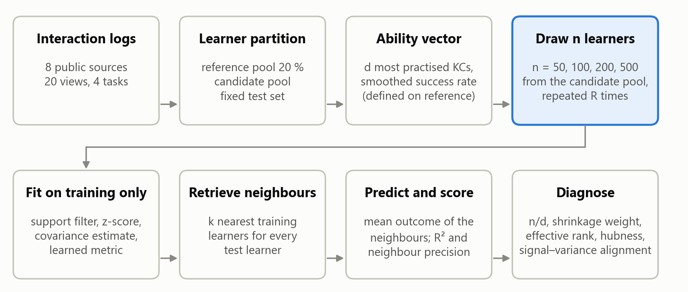
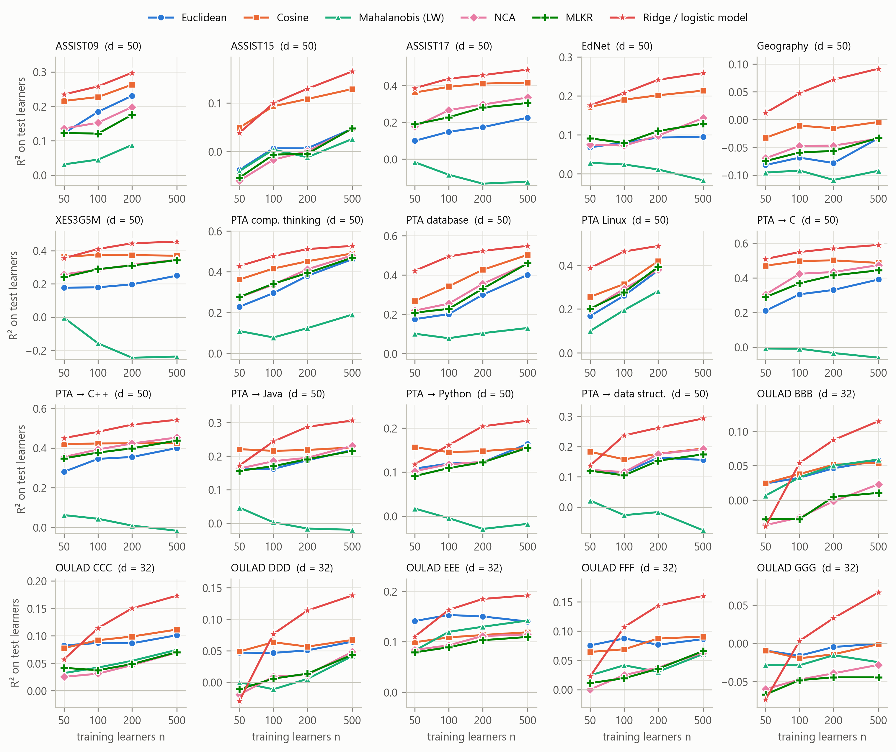
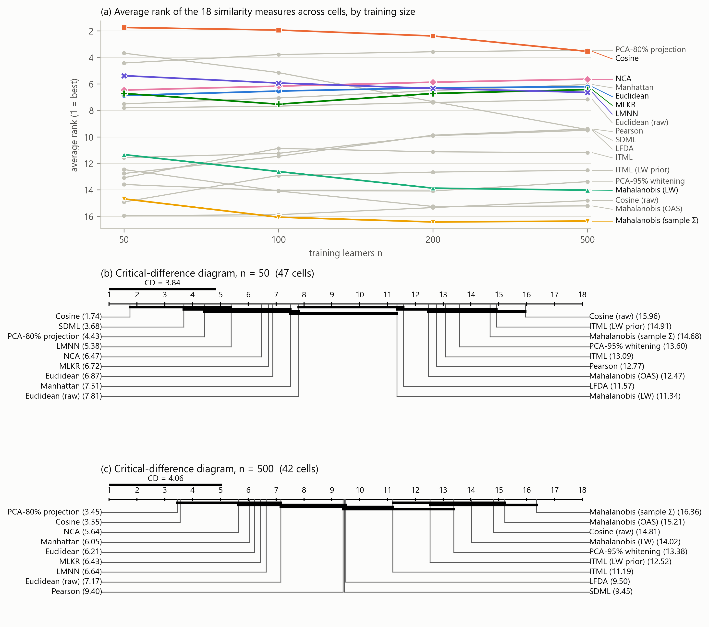
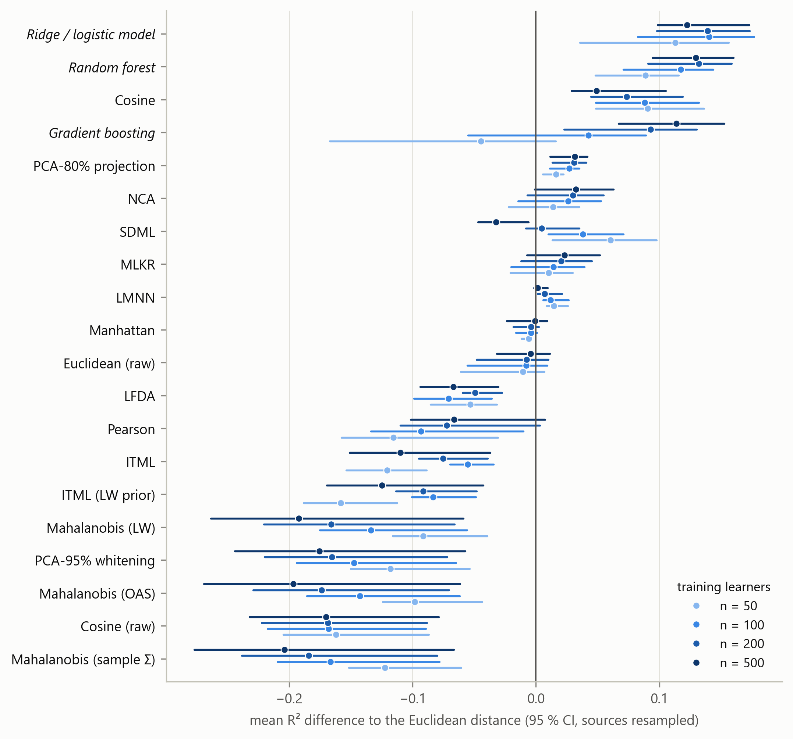
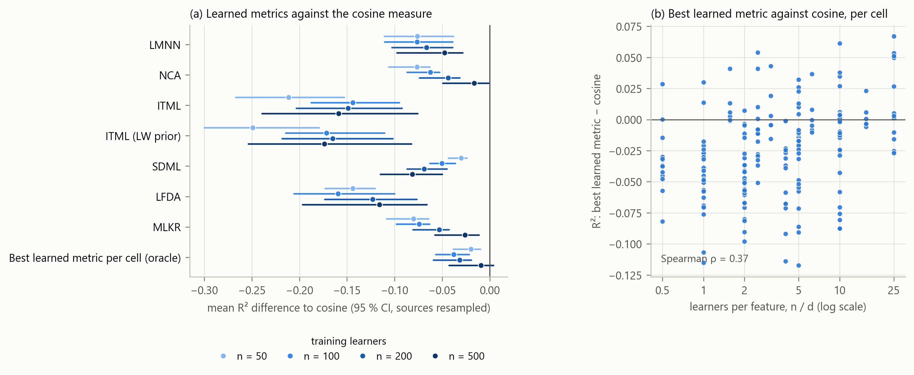
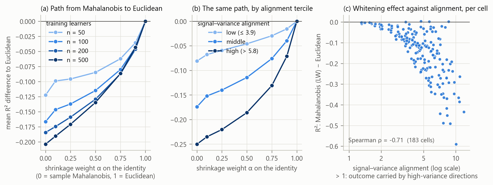
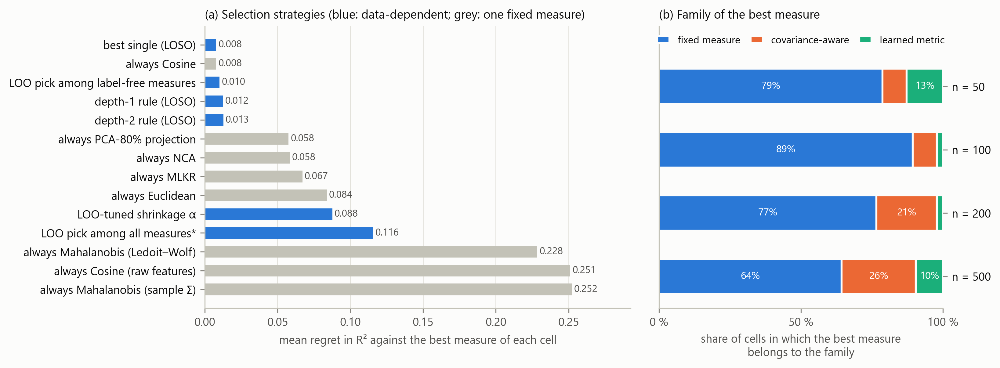
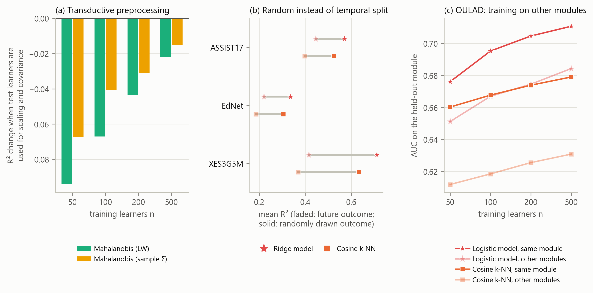

# Which Similarity Measure for Similar-Learner Retrieval? A Small-Sample Benchmark of Fixed, Covariance-Aware and Learned Metrics on Eight Public Datasets

Nguyễn Thanh Bình¹, Nguyễn Vũ Huy¹, Nguyễn Hoàng Tín¹, Võ Anh Hào¹, Vũ Ngọc Thanh Sang¹

¹ Faculty of Information Technology, Saigon University, Ho Chi Minh City, Vietnam

Corresponding author: Vũ Ngọc Thanh Sang ([email to be added])

ORCID: Nguyễn Thanh Bình, https://orcid.org/0009-0000-9285-7324

ORCID: Nguyễn Vũ Huy, https://orcid.org/0009-0004-3093-4565

ORCID: Nguyễn Hoàng Tín, https://orcid.org/0009-0006-0273-7956

**Draft status:** complete first draft generated from the experiment outputs on 2026-11-11. Every number, table and figure below is produced by the code in this repository from 40 repetitions per cell.

---

## Abstract

Retrieval-augmented knowledge tracing, cold-start matching and adaptive tutoring agents all retrieve learners who are "similar" to a given learner, yet the similarity measure is chosen without comparison: cosine in some systems, hand-weighted mixtures or a Mahalanobis distance in others. It is unknown which measure works when ability vectors are correlated and sparse and only a small cohort is available, or how the answer changes with the number of learners. We benchmark 23 similarity measures (Euclidean, Manhattan, cosine and Pearson; Mahalanobis distances with sample and shrinkage covariance; PCA variants; and seven learned metrics including LMNN, NCA, ITML and MLKR) and three non-metric models on 20 learner views built from eight public sources, across four prediction tasks, feature dimensions of 20 to 100 and cohorts of 50 to 500 learners, with learner-disjoint evaluation and 40 repetitions in each of 183 cells. The cosine similarity on standardised vectors is the best or co-best retrieval measure at every cohort size (mean R² 0.22 to 0.26, against 0.12 to 0.22 for Euclidean). Every form of whitening falls to the level of predicting the mean (Ledoit–Wolf Mahalanobis minus Euclidean: −0.14 R², in all eight sources), and the loss grows with the cohort. Learned metrics reach cosine at 500 learners and do not exceed it. A diagnostic that we call the signal–variance alignment explains the pattern: in every cell the outcome is carried by the high-variance directions that whitening suppresses (rank correlation with the whitening loss −0.71). No selection rule learned on other sources beats always using cosine; selection inside the cohort helps only from about 200 learners. A random instead of temporal outcome split inflates R² by about 52%. We release the pipeline, code and a datasheet.

**Keywords:** learner similarity, nearest-neighbour retrieval, Mahalanobis distance, metric learning, covariance shrinkage, small samples, knowledge tracing, benchmark, reproducibility

---

## 1. Introduction

Many educational systems answer a question about one learner by looking at other learners who resemble them. Retrieval-augmented knowledge tracing places the records of similar students in the prompt of a language model (Duan et al., 2025; Duan et al., 2026). Agents for adaptive learning pick the next exercise by weighting what worked for similar past learners (Lv et al., 2025). Cold-start methods match a new learner to a group of existing ones (Deng et al., 2025). In all of these systems one component decides which learners count as "similar": a similarity measure applied to a vector that describes each learner's ability.

That component is almost never examined. Lv et al. (2025) use the cosine similarity between mastery vectors produced by a knowledge-tracing model. Duan et al. (2026) combine a cosine term, a graph-distance term and an ability term with hand-set weights. Duan et al. (2025) use a Mahalanobis distance with a shrinkage covariance over five pair features. Deng et al. (2025) replace the measure with K-means clusters. None of these papers compares its choice with an alternative, and none reports how the choice behaves when few learners are available.

Two intuitions pull in opposite directions. Ability dimensions are correlated: skills share prerequisites, and a strong learner is strong on many skills at once. The Mahalanobis distance was designed for correlated variables (Mahalanobis, 1936), and a recent survey of learning-path recommendation names the correlation and poor identifiability of learner features as an open problem (Li et al., 2026). This suggests a covariance-aware measure. Yet the covariance matrix of d features has d(d + 1)/2 free entries, and a new course, a single class or a pilot deployment may offer only tens or hundreds of learners. The sample covariance is then badly conditioned or singular (Ledoit & Wolf, 2004). Supervised metric learning promises to learn which directions matter (Weinberger & Saul, 2009; Davis et al., 2007), but it adds parameters and needs outcome labels, and its own authors report mixed results on small data sets (Weinberger & Saul, 2009).

A practitioner who has n learners and d ability features therefore has no evidence to decide between the Euclidean distance, the cosine similarity, a Mahalanobis distance, or a learned metric. This paper provides that evidence. We ask four questions.

- **RQ1.** For training cohorts of 50, 100, 200 and 500 learners, which similarity measure gives the best nearest-neighbour prediction of a held-out outcome, and how does the ranking change with n and d?
- **RQ2.** How much does covariance shrinkage recover compared with the sample covariance, and do learned metrics improve on the best label-free measure?
- **RQ3.** Which properties of the data explain when a covariance-aware or learned measure helps or hurts?
- **RQ4.** Can a simple rule, or a selection made inside the training sample, choose the measure for a data set it has not seen?

The paper makes five contributions.

1. **A benchmark of 23 similarity measures** (fixed, covariance-aware and learned) and three non-metric baselines on 20 learner views built from 8 independent public sources, covering four prediction tasks and 183 cells of (view, feature dimension, training size), with 40 repetitions per cell.
2. **A leakage-controlled protocol**: learners are split before any feature is defined, every estimate is fitted on training learners only, and three protocol shortcuts (transductive scaling, a random instead of temporal outcome split, and training on the same module) are measured rather than assumed harmless.
3. **A mechanism**: a single diagnostic, the signal–variance alignment, that says whether the outcome is carried by high-variance or low-variance directions of the ability vector and explains when whitening hurts.
4. **A selection study**: fixed choices, rules learned on other sources, and selection inside the training sample are compared by their regret against the best measure of each cell under leave-one-source-out evaluation.
5. **A reproducibility package**: download script with checksums, view builder, experiment runner, analysis and figure code, pinned library versions and a datasheet. Only public, already anonymised data are used.

## 2. Related work

### 2.1 Similar-learner retrieval in knowledge tracing and path recommendation

Knowledge tracing estimates a learner's mastery from the history of their responses (Corbett & Anderson, 1995; Piech et al., 2015). A recent line of work adds retrieval. ReAL (Lv et al., 2025) builds a datastore of past learners keyed by their mastery vectors from a deep knowledge-tracing model and retrieves the five most similar ones with the cosine similarity. RAG-KT (Duan et al., 2026) retrieves two similar students with a hand-weighted mixture of a behaviour cosine, a graph path score and an item-response-theory ability gap. HISE-KT (Duan et al., 2025) scores candidate students with a Mahalanobis distance whose covariance is estimated from training pairs and regularised by shrinkage, over a five-dimensional vector of pair features. Its ablation removes the similar-student component as a whole and does not vary the distance. ACKT (Deng et al., 2025) addresses cold start across disciplines on PTADisc by clustering knowledge states with K-means, which is a hard notion of similarity.

Goal-oriented learning-path recommenders rarely retrieve learners at all. GEHRL (Li et al., 2023), KnowLP (Cheng et al., 2026) and IB-GRPO (Wang et al., 2026) encode the learner with a recurrent network or a mastery vector and are evaluated on simulators built from a knowledge-tracing model. Where a nearest-neighbour baseline appears, it uses the cosine similarity between learning paths. Outside knowledge tracing, the Mahalanobis distance has been used inside a density-based clustering of learners on OULAD (Bagunaid et al., 2022), again without a comparison with another distance.

We found no study that compares similarity measures for learner retrieval, and none that learns the metric. This statement is limited to the literature we read in full for this project and is not a systematic review.

### 2.2 Covariance-aware and learned metrics

The Mahalanobis distance (x − y)ᵀ M (x − y) with M = Σ⁻¹ equals the Euclidean distance after whitening the data. When n is not much larger than d, the sample covariance has a few very small eigenvalues and its inverse amplifies noise. Ledoit and Wolf (2004) and Chen et al. (2010) shrink the sample covariance towards a scaled identity with a data-driven weight; the result is always invertible. Truncated principal-component whitening regularises by discarding small eigenvalues instead.

Metric learning chooses M from supervision (Bellet et al., 2013; Kulis, 2013). Large-margin nearest neighbour (LMNN) pulls same-class neighbours together and pushes other classes away (Weinberger & Saul, 2009). Neighbourhood components analysis (NCA) maximises a soft leave-one-out nearest-neighbour accuracy (Goldberger et al., 2004). Information-theoretic metric learning (ITML) stays close to a prior metric in LogDet divergence under pair constraints (Davis et al., 2007). Sparse determinant metric learning (SDML) adds an ℓ1 penalty on the off-diagonal entries of M, which links it to sparse precision estimation (Qi et al., 2009; Friedman et al., 2008). Local Fisher discriminant analysis (LFDA) has a closed form (Sugiyama, 2007). Metric learning for kernel regression (MLKR) is fitted on a continuous outcome and needs no class labels (Weinberger & Tesauro, 2007). Bellet et al. (2013) note that LMNN can overfit without regularisation and depends on the Euclidean choice of target neighbours, and Davis et al. (2007) report higher variance when few constraints are available. Neither source studies the dependence on n and d for learner data.

### 2.3 Benchmarks and evaluation hygiene

Careful benchmarks have repeatedly changed what a field believed. Musgrave et al. (2020) re-evaluated deep metric learning under a common protocol and found that reported progress had been largely an artefact of unequal comparisons. Liu et al. (2022) standardised preprocessing for deep knowledge tracing and found that evaluation mistakes cause label leakage and that many recent models gain little over the original deep knowledge-tracing model. Hidasi and Czapp (2023) list widespread flaws in the offline evaluation of recommender systems, including temporal leakage. Feldbauer and Flexer (2019) compare hubness-reduction methods on 50 data sets with the Friedman and Nemenyi procedure of Demšar (2006); Benavoli et al. (2017) argue for Bayesian comparison with a region of practical equivalence.

Educational prediction has the same problems. In a review of 89 studies of reinforcement learning in education, 54 reported no statistical test (Riedmann et al., 2025). A review of educational recommender systems found that 12 of 28 studies optimised a rating target and only 5 used a public data set (Askarbekuly & Luković, 2024). On OULAD, replacing a random learner split by leave-one-module-out lowered the AUROC of an early-warning model from 0.716 to 0.661 (Lim, 2026), and an audit of seven public educational data sets found that several lose all predictive skill under group-disjoint evaluation (Ma & Zhang, 2026). Our protocol is designed against these failure modes, and Section 4.5 measures three of them directly.

## 3. Benchmark design

### 3.1 Task

Each learner i has an ability vector xᵢ ∈ ℝᵈ and an outcome yᵢ that is observed for training learners only. Given a query learner, a similarity measure retrieves the k most similar training learners, and the prediction is the mean outcome of those neighbours. The quality of the measure is the quality of this prediction on test learners who share no data with the training learners. This task isolates the retrieval component: it needs no simulator and no language model, so differences between measures cannot be attributed to another part of a larger system.

Figure 1 summarises the protocol.

*Figure 1. Benchmark protocol. The features are defined on a reference pool, training cohorts of n learners are drawn repeatedly from a candidate pool, and everything that is estimated (scaling, covariance, learned metric) uses the training cohort only. Test learners are fixed and never used for fitting.*

### 3.2 Data sources and views

We use eight independent public sources (Table 1): ASSISTments 2009, 2015 and 2017 (Feng et al., 2009), EdNet-KT1 (Choi et al., 2020) in the 20,000-learner sample released with DKT2 (Zhou et al., 2025), XES3G5M (Liu et al., 2023), the Slepemapy geography practice data (Papoušek et al., 2016), PTADisc (Hu et al., 2023) and OULAD (Kuzilek et al., 2017). They cover middle-school and primary mathematics, English practice, geography facts, university programming and computing courses, and distance higher education. The datasheet in the repository lists licences, download locations, checksums and the columns that are deliberately not read. No demographic attribute is used anywhere: for OULAD we do not load gender, region, education, deprivation band, age band or disability.

A *view* is a learner-level table with one outcome. The 20 views fall into four task types.

- **Future performance** (6 views). Features use the first 70 % of a learner's interactions; the outcome is the success rate on the last 30 %.
- **Cross-course transfer** (5 views). On the 29,454 PTADisc learners who took five programming courses, the outcome is the mean score in one held-out course and the features come from the other four.
- **Unseen skills** (3 views). On three PTADisc courses without timestamps, a random 70 % of the knowledge components supply the features and the outcome is the mean score on items of the remaining 30 %.
- **Early warning** (6 views). For six OULAD modules, the outcome is non-completion (fail or withdraw) and the features describe the first 28 days.

**Table 1. Views of the benchmark.** *pool* is the candidate pool from which training cohorts are drawn; *density* is the share of (learner, feature) entries backed by at least one attempt, given as the range over the feature dimensions d.

| Source | View | Domain | Task | Learners | Pool | Test | d | Density | Outcome mean | Outcome SD |
|---|---|---|---|---|---|---|---|---|---|---|
| ASSISTments 2009 | assist09 | middle-school mathematics | future performance | 1159 | 556 | 371 | 20/50/100 | 0.21–0.47 | 0.625 | 0.213 |
| ASSISTments 2015 | assist15 | middle-school mathematics | future performance | 4430 | 2544 | 1000 | 20/50/100 | 0.12–0.22 | 0.738 | 0.156 |
| ASSISTments 2017 | assist17 | middle-school mathematics | future performance | 1670 | 802 | 534 | 20/50/100 | 0.37–0.53 | 0.408 | 0.137 |
| EdNet-KT1 (20k sample) | ednet | English (TOEIC) practice | future performance | 3630 | 1904 | 1000 | 20/50/100 | 0.58–0.75 | 0.648 | 0.123 |
| OULAD | oulad_BBB | distance higher education | early warning | 6291 | 4033 | 1000 | 32 | 1.00 | 0.411 | 0.492 |
| OULAD | oulad_CCC | distance higher education | early warning | 3418 | 1734 | 1000 | 32 | 1.00 | 0.518 | 0.500 |
| OULAD | oulad_DDD | distance higher education | early warning | 4996 | 2997 | 1000 | 32 | 1.00 | 0.492 | 0.500 |
| OULAD | oulad_EEE | distance higher education | early warning | 2508 | 1204 | 802 | 32 | 1.00 | 0.347 | 0.476 |
| OULAD | oulad_FFF | distance higher education | early warning | 6343 | 4074 | 1000 | 32 | 1.00 | 0.435 | 0.496 |
| OULAD | oulad_GGG | distance higher education | early warning | 2432 | 1168 | 778 | 32 | 1.00 | 0.379 | 0.485 |
| PTADisc cross-course | pta_x_c | university programming | cross-course transfer | 29454 | 25454 | 1000 | 20/50/100 | 0.44–0.67 | 0.734 | 0.155 |
| PTADisc cross-course | pta_x_cpp | university programming | cross-course transfer | 29454 | 25454 | 1000 | 20/50/100 | 0.47–0.78 | 0.728 | 0.181 |
| PTADisc cross-course | pta_x_ds | university programming | cross-course transfer | 29454 | 25454 | 1000 | 20/50/100 | 0.47–0.82 | 0.757 | 0.179 |
| PTADisc cross-course | pta_x_java | university programming | cross-course transfer | 29454 | 25454 | 1000 | 20/50/100 | 0.52–0.82 | 0.754 | 0.193 |
| PTADisc cross-course | pta_x_python | university programming | cross-course transfer | 29454 | 25454 | 1000 | 20/50/100 | 0.53–0.82 | 0.750 | 0.198 |
| PTADisc single-course | pta_comp_thinking | computational thinking | unseen skills | 19923 | 15923 | 1000 | 20/50/100 | 0.26–0.50 | 0.754 | 0.184 |
| PTADisc single-course | pta_database | database technology | unseen skills | 7784 | 5227 | 1000 | 20/50/100 | 0.16–0.44 | 0.760 | 0.169 |
| PTADisc single-course | pta_linux | Linux systems | unseen skills | 1279 | 614 | 409 | 20/50 | 0.30–0.48 | 0.668 | 0.188 |
| Slepemapy geography | slepemapy | geography facts | future performance | 31199 | 27199 | 1000 | 20/50/100 | 0.27–0.38 | 0.776 | 0.155 |
| XES3G5M | xes3g5m | primary mathematics | future performance | 18066 | 14066 | 1000 | 20/50/100 | 0.52–0.76 | 0.799 | 0.141 |

The five cross-course views share their learners, and the six OULAD views come from one institution. Whenever an analysis needs independent units, views are grouped into the eight sources.

### 3.3 Ability vectors

One rule builds the vectors for every interaction-log source. Learners are shuffled once per source and split into a reference pool (20 %, at most 3,000 learners), a fixed test set (at most 1,000) and a candidate pool. The reference pool alone defines the features: the d knowledge components (KCs) practised by the most reference learners are kept, with d ∈ {20, 50, 100}. For learner i and KC k with nᵢₖ attempts and cᵢₖ successes, the feature is the smoothed success rate

fᵢₖ = (cᵢₖ + a pₖ) / (nᵢₖ + a), with a = 2,

where pₖ is the mean success on KC k in the reference pool. A KC that the learner never attempted takes the value pₖ. The resulting vectors are sparse in the sense that matters here: at d = 100 only 12 % to 58 % of the entries are backed by an attempt (Table 1). OULAD has no KCs; its 32 features are registration lead time, previous attempts, studied credits, log-scaled click counts by week and by activity type, active days, distinct resources and the number of assessments handed in by day 28.

Inside each repetition, a column is dropped when fewer than five training learners depart from its most frequent value, which removes KCs that almost no training learner practised. The remaining columns are standardised with the training mean and standard deviation and clipped at ±5. Without the support filter, a KC practised by one or two training learners receives a near-zero standard deviation and dominates every distance; during development we observed strongly negative R² for the distance-based measures and for the linear model in such cohorts.

### 3.4 Similarity measures

Table 2 lists the 23 measures. All except the two "raw" variants operate on the standardised vectors.

**Table 2. Similarity measures and baselines.**

| Family | Measure | Definition and settings |
|---|---|---|
| Fixed | Euclidean, Manhattan | ℓ2 and ℓ1 distance |
| Fixed | Cosine | 1 − cosine of the angle between the two vectors |
| Fixed | Pearson | cosine after centring each learner's vector |
| Fixed | Euclidean (raw), Cosine (raw) | the same on unstandardised success rates, as used on mastery vectors in earlier work |
| Covariance-aware | Mahalanobis (sample Σ) | M = pseudo-inverse of the sample covariance |
| Covariance-aware | Mahalanobis (Ledoit–Wolf), Mahalanobis (OAS) | M = inverse of the shrinkage covariance, weight chosen by the estimator |
| Covariance-aware | Mahalanobis α | M = ((1 − α) S + α I)⁻¹ for α ∈ {0.10, 0.25, 0.50, 0.75, 0.90}; α = 1 is Euclidean |
| Covariance-aware | PCA-95 % whitening | whitening restricted to the components that explain 95 % of the variance |
| Covariance-aware | PCA-80 % projection | Euclidean distance in the span of the components that explain 80 % of the variance, without whitening |
| Learned | LMNN | 3 target neighbours, 200 iterations (metric-learn 0.7.0) |
| Learned | NCA | 100 iterations (scikit-learn 1.7.2) |
| Learned | ITML, ITML (LW prior) | 20c² pair constraints, identity prior or Ledoit–Wolf precision as prior |
| Learned | SDML | Ledoit–Wolf precision as prior, sparsity 0.01, balance 0.5 (our re-implementation, see text) |
| Learned | LFDA | at most 7 neighbours |
| Learned | MLKR | 100 iterations, fitted on the continuous outcome |
| Non-metric | Ridge / logistic regression | penalty chosen by internal cross-validation |
| Non-metric | Random forest | 200 trees, minimum leaf size 3 |
| Non-metric | Gradient boosting | 150 iterations, learning rate 0.05, depth 3 |

The five fixed-α measures are used only to trace the path between the Mahalanobis and the Euclidean distance (Section 4.3); the main comparison ranks the other 18 measures. The Mahalanobis family is the family of Euclidean distances after a linear map, so the three covariance estimators differ only in how strongly they whiten.

The learned metrics that require class labels (LMNN, NCA, ITML, SDML, LFDA) receive the tertiles of the training outcome, or the two classes for the binary task. MLKR uses the outcome directly. SDML in metric-learn 0.7.0 calls a graphical-lasso routine with an argument that scikit-learn removed in version 1.5; we re-implemented the same estimator with the pair loss averaged per pair type and the eigenvalues of the input matrix floored at 10⁻³ of the largest. All other learners use the library implementations with the settings in Table 2. Hyper-parameters are fixed, not tuned per cell: the question is what a practitioner obtains from a standard configuration at small n, and tuning inside 50 learners is itself unreliable (Section 4.4). When a learner fails (for example a singular scatter matrix), the measure falls back to the Euclidean distance and the failure is counted (Section 4.6).

### 3.5 Prediction, scores and non-metric baselines

Predictions use the k = 10 nearest training learners with equal weights; k = 5 and k = 20 are reported as a sensitivity analysis. The score is

R² = 1 − MSE(prediction) / MSE(training-mean predictor),

computed on the test learners. For the binary outcome the prediction is the share of positive neighbours and R² is the Brier skill score, so all views share one scale on which 0 means "no better than predicting the training mean". We also report the AUC for the binary task and the *neighbour precision*, the share of the k retrieved learners who fall in the same outcome class as the query.

Three non-metric models are trained on the same standardised vectors to show what is achievable without retrieval. They are not competitors in the ranking of measures: a retrieval system needs neighbours, not only a prediction. Their predictions are clipped to [0, 1], the range of every outcome.

### 3.6 Protocol

A *cell* is a combination of view, feature dimension d and training size n ∈ {50, 100, 200, 500}. A cell is run only when the candidate pool holds at least 1.5 n learners, which gives 183 cells. In each of 40 repetitions per cell, n training learners are drawn without replacement from the candidate pool, all measures and models are fitted on them, and all are scored on the same fixed test learners. Comparisons between measures are therefore paired within a repetition. The benchmark comprises 183,000 fitted measure–cohort pairs.

Three protocol variants are measured against this baseline.

1. **Transductive preprocessing.** Scaling and the covariance are estimated on training and test learners together, without labels. This is the common shortcut of standardising a table before splitting it.
2. **Random outcome split.** For three temporal sources, the outcome interactions are drawn at random from the learner's sequence instead of from its end.
3. **Leave-one-module-out.** For OULAD, the training cohort is drawn from the other five modules, after removing every learner who also appears in the held-out module.

### 3.7 Diagnostics and the signal–variance alignment

For every training cohort we record label-free properties of the standardised matrix: n/d, the Ledoit–Wolf shrinkage weight, the effective rank of the covariance (Roy & Vetterli, 2007) divided by d, the share of variance on the first principal component, the mean absolute correlation, the share of dropped columns, the two-nearest-neighbour estimate of intrinsic dimension (Facco et al., 2017) divided by d, and the skewness of the 10-occurrence distribution, a standard hubness measure (Radovanović et al., 2010).

We add one diagnostic that uses the training outcome. Let λⱼ be the eigenvalues of the training covariance, and ρⱼ the correlation between the outcome and the score on the j-th principal component. The **signal–variance alignment** is

SVA = Σⱼ ρⱼ² λⱼ / (Σⱼ ρⱼ² · λ̄), with λ̄ the mean eigenvalue.

SVA is the ρ²-weighted mean eigenvalue relative to the plain mean. SVA > 1 means that the outcome is carried by high-variance directions; SVA < 1 means that it is carried by low-variance directions.

The diagnostic follows from how the two distances treat the principal directions. A Euclidean ball has the same radius in every direction, so relative to the spread of the data it is narrow along high-variance directions and wide along low-variance ones: neighbours are matched mainly on the high-variance components, and the effective dimension of the search is close to the participation ratio (Σλ)² / Σλ², which is smaller than d when the features are correlated. Whitening gives every direction the same weight. It raises the effective dimension to the rank of the covariance, which makes the neighbourhoods larger for a given k, and it stops favouring the high-variance directions. If the outcome is carried by those directions (SVA > 1), whitening removes a useful bias and adds dimensions that carry little signal; if the outcome is carried by low-variance directions (SVA < 1), whitening should help. This argument is heuristic and we test its prediction in Section 4.3.

### 3.8 Statistical analysis

The unit of analysis is the cell mean over repetitions. Measures are compared by average rank with the Friedman test in the Iman–Davenport form and the Nemenyi critical difference (Demšar, 2006), separately for each n. Because cells from one source are not independent, we also report the same test with one block per source, and every confidence interval for a mean difference resamples whole sources (5,000 cluster-bootstrap replicates). Planned pairwise contrasts use the Wilcoxon signed-rank test with the Holm correction within each n, and the Bayesian signed-rank test (Benavoli et al., 2017) with a region of practical equivalence of ±0.01 in R², which returns the posterior probabilities that one measure is practically better, equivalent or worse. With eight sources, the source-level tests have little power; we treat them as a check on direction, and report the number of sources in which a difference is positive.

### 3.9 Selection strategies

For RQ4 the *regret* of a strategy in a cell is the R² of the best of the 18 measures in that cell minus the R² of the measure the strategy selects. We compare four kinds of strategy.

- **Always one measure**: each of the 18.
- **Best single measure, learned elsewhere**: the measure with the lowest mean regret on the other sources.
- **A rule learned elsewhere**: a regret-minimising tree of depth 1 or 2 on the diagnostics of Section 3.7 (thresholds at 17 quantiles, at least 8 cells per leaf).
- **Selection inside the training cohort**: the measure with the best leave-one-out nearest-neighbour R² among the training learners. This is a valid internal estimate for label-free measures. For learned metrics it is a resubstitution estimate, because the metric has already seen the left-out label; we include that naive variant to show its cost. A third variant tunes only the shrinkage weight α.

Rules and the best single measure are evaluated by leave-one-source-out: they are fitted on seven sources and applied to the eighth.

## 4. Results

All results use 40 repetitions per cell and k = 10 unless stated otherwise. Differences are in R² points; brackets give 95 % cluster-bootstrap intervals that resample the eight sources.

### 4.1 RQ1: Which measure works, and how does the ranking change with n?

Table 3 gives the mean R² and the average rank of every measure by training size, Figure 2 shows the learning curves of six representative methods in each view, and Figure 3 shows the ranks.

**Table 3. Mean R² over cells and average rank among the 18 similarity measures, by training size n.** Ranks are computed within each cell (1 = best). The three non-metric models are not ranked.

| Measure / model | Family | R² n=50 | R² n=100 | R² n=200 | R² n=500 | R² all | rank n=50 | rank n=100 | rank n=200 | rank n=500 | rank all |
|---|---|---|---|---|---|---|---|---|---|---|---|
| Euclidean | fixed | 0.125 | 0.149 | 0.183 | 0.216 | 0.167 | 6.872 | 6.543 | 6.298 | 6.214 | 6.489 |
| Manhattan | fixed | 0.119 | 0.144 | 0.179 | 0.215 | 0.163 | 7.511 | 7.064 | 6.511 | 6.048 | 6.803 |
| Cosine | fixed | 0.215 | 0.237 | 0.256 | 0.265 | 0.243 | 1.745 | 1.936 | 2.383 | 3.548 | 2.372 |
| Pearson | fixed | 0.009 | 0.055 | 0.110 | 0.149 | 0.079 | 12.766 | 11.468 | 9.872 | 9.405 | 10.918 |
| Euclidean (raw features) | fixed | 0.114 | 0.141 | 0.175 | 0.211 | 0.159 | 7.809 | 7.681 | 7.404 | 7.167 | 7.525 |
| Cosine (raw features) | fixed | -0.037 | -0.020 | 0.014 | 0.045 | -0.001 | 15.957 | 15.872 | 15.340 | 14.810 | 15.514 |
| Mahalanobis (sample Σ) | covariance | 0.002 | -0.018 | -0.002 | 0.012 | -0.002 | 14.681 | 16.064 | 16.426 | 16.357 | 15.869 |
| Mahalanobis (Ledoit–Wolf) | covariance | 0.033 | 0.015 | 0.017 | 0.023 | 0.022 | 11.340 | 12.617 | 13.872 | 14.024 | 12.934 |
| Mahalanobis (OAS) | covariance | 0.026 | 0.006 | 0.009 | 0.019 | 0.015 | 12.468 | 14.085 | 15.255 | 15.214 | 14.230 |
| PCA-95% whitening | covariance | 0.007 | 0.001 | 0.017 | 0.040 | 0.016 | 13.596 | 14.064 | 14.085 | 13.381 | 13.792 |
| PCA-80% projection | covariance | 0.141 | 0.176 | 0.214 | 0.247 | 0.193 | 4.426 | 3.787 | 3.574 | 3.452 | 3.820 |
| LMNN | learned | 0.139 | 0.160 | 0.190 | 0.217 | 0.176 | 5.383 | 5.936 | 6.340 | 6.643 | 6.060 |
| NCA | learned | 0.139 | 0.175 | 0.213 | 0.248 | 0.192 | 6.468 | 6.170 | 5.872 | 5.643 | 6.049 |
| ITML (identity prior) | learned | 0.004 | 0.093 | 0.107 | 0.106 | 0.077 | 13.085 | 10.872 | 11.128 | 11.190 | 11.579 |
| ITML (LW prior) | learned | -0.034 | 0.065 | 0.091 | 0.091 | 0.052 | 14.915 | 12.915 | 12.660 | 12.524 | 13.273 |
| SDML | learned | 0.185 | 0.186 | 0.187 | 0.183 | 0.186 | 3.681 | 5.149 | 7.340 | 9.452 | 6.322 |
| LFDA | learned | 0.071 | 0.078 | 0.133 | 0.149 | 0.107 | 11.574 | 11.245 | 9.915 | 9.500 | 10.587 |
| MLKR | learned | 0.135 | 0.163 | 0.203 | 0.239 | 0.183 | 6.723 | 7.532 | 6.723 | 6.429 | 6.863 |
| Ridge / logistic | model | 0.238 | 0.289 | 0.322 | 0.338 | 0.296 |  |  |  |  |  |
| Random forest | model | 0.214 | 0.266 | 0.315 | 0.345 | 0.283 |  |  |  |  |  |
| Gradient boosting | model | 0.080 | 0.191 | 0.276 | 0.330 | 0.216 |  |  |  |  |  |

*Figure 2. R² on the fixed test learners against the number of training learners, for each view at d = 50 (OULAD: its 32 features). Mean over 40 repetitions. The vertical scale differs between panels.*

The measures differ strongly. The Friedman test rejects equal ranks at every training size, with cells as blocks (n = 50: χ² = 531.0, N = 47, K = 18; n = 500: χ² = 424.5, N = 42; both p < 0.001) and with the eight sources as blocks (n = 50: χ² = 99.9, N = 8, p < 0.001; Table A1).

**The cosine similarity on standardised vectors is the best retrieval measure.** Its average rank is 1.74 at n = 50, 1.94 at n = 100 and 2.38 at n = 200, the best of the 18 measures at each of these sizes. At n = 500 it has rank 3.55, level with the PCA-80 % projection (3.45); the gap between the two is far below the critical difference of 4.06. Cosine is the best of the 18 measures in 116 of the 183 cells and has the highest mean R² in 7 of the 8 sources (Table A3). Its mean R² rises from 0.215 at n = 50 to 0.265 at n = 500, against 0.125 to 0.216 for the Euclidean distance. The mean advantage over the Euclidean distance is +0.076 [+0.042, +0.123] and is positive in 7/8 sources. The exception is OULAD, the only source with dense features, where the fixed measures are within 0.008 of one another (Euclidean 0.067, cosine 0.062, Pearson 0.070).

**Standardisation matters more than the choice between Euclidean and cosine.** The cosine similarity applied to the unstandardised success rates has a mean R² of −0.001, no better than predicting the training mean, and an average rank of 15.51 out of 18. The difference to the standardised version is +0.243 [+0.134, +0.331], positive in 8/8 sources. Raw success rates are all positive and share a large common level, so the angle between two raw vectors carries little information. We did not evaluate mastery vectors produced by a deep knowledge-tracing model, so this result does not transfer directly to the systems cited in Section 2.1; it does show that the same measure can be the best or among the worst depending on preprocessing that those papers do not report.

**Whitening removes most of the signal.** The three Mahalanobis distances and PCA whitening have mean R² between −0.002 and 0.022 and average ranks between 12.93 and 15.87. At both n = 50 and n = 500 each of the four ranks below cosine by more than twice the critical difference, and the sample-covariance version ranks below the Euclidean distance by more than the critical difference (Figure 3).

*Figure 3. (a) Average rank of each measure by training size; seven measures are highlighted and the others are shown in grey. (b, c) Critical-difference diagrams at the smallest and largest training size. Measures joined by a bar do not differ significantly under the Nemenyi test at α = 0.05. Cells from one source are not independent, so the bars are liberal; Table A1 gives the source-level tests.*

**Non-metric models predict better, and the gap opens with n.** Ridge regression exceeds cosine retrieval by +0.053 [+0.031, +0.064] over all cells. At n = 50 the difference is +0.022 [−0.017, +0.040], positive in 6/8 sources but not significant after the Holm correction (p = 0.06); at n = 500 it is +0.074 [+0.059, +0.080], positive in 7/7 sources. With 50 learners, retrieving ten cosine neighbours predicts about as well as a regularised linear model. Figure 4 places every method relative to the Euclidean distance.

*Figure 4. Mean R² difference to the Euclidean distance for every measure and model, by training size, with 95 % cluster-bootstrap intervals. Non-metric models are in italics.*

### 4.2 RQ2: Does shrinkage help, and do learned metrics pay off?

**Shrinkage improves on the sample covariance, but both remain far below the Euclidean distance.** The Ledoit–Wolf Mahalanobis distance exceeds the sample-covariance version by +0.024 [+0.010, +0.030], and by more at n = 50 (+0.031) than at n = 500 (+0.012), as estimation theory predicts. Yet the Ledoit–Wolf distance trails the Euclidean distance. The difference is −0.145 [−0.193, −0.054]; it is negative in every source (0/8 positive) and in 97.8% of the cells. The Bayesian signed-rank test puts the probability that it is practically worse at 1.000.

The difference widens with the sample: −0.091 at n = 50 and −0.192 at n = 500. A problem of estimation would shrink with n. This one does not, which points to the target of the estimate, not its precision: the better the covariance is estimated, the more completely the data are whitened, and the worse the retrieval. Section 4.3 follows this up.

**Learned metrics do not improve on cosine at these sample sizes.** NCA trails cosine, with a difference of −0.051 [−0.079, −0.040] over all cells; the gap narrows from −0.076 at n = 50 to −0.017 at n = 500 (Figure 5a). MLKR behaves in the same way (−0.080 to −0.026). LMNN in its default configuration stays practically equivalent to the Euclidean distance from which its target neighbours are chosen (difference +0.009, posterior probability of practical equivalence 0.999). SDML, which starts from a shrinkage prior, is the best learned metric at n = 50 (rank 3.68) and loses ground as n grows (rank 9.45 at n = 500).

Even an oracle that picks the best of the seven learned metrics separately in every cell trails cosine: the difference is −0.025 [−0.050, −0.014] over all cells. At n = 500 the oracle's difference is −0.009 [−0.043, +0.003], an interval that includes zero. A learned metric is the best measure in 13% of the cells at n = 50 (SDML in 6 cells) and in 10% at n = 500 (NCA in 4 cells).

*Figure 5. (a) Mean R² difference between each learned metric and the cosine measure, by training size, with 95 % cluster-bootstrap intervals. The last row is an oracle that takes the best learned metric of each cell. (b) The oracle's difference to cosine in each cell against the number of learners per feature.*

**Sensitivity to hyper-parameters.** Table A12 varies the configuration of the three most competitive learners on the d = 50 views (38 cells, 10 repetitions on the cohorts of the main grid). A rank-10 constraint is the only change with a clear effect: it raises LMNN by +0.045 at n = 100 and +0.055 at n = 500, which brings it to +0.004 [−0.020, +0.017] of cosine at n = 500. The number of target neighbours and the number of classes into which the outcome is cut change the result by less than 0.03 in either direction. Taking the best of all thirteen configurations in each cell, with hindsight, gives −0.015 relative to cosine at n = 100 and +0.006 at n = 500. Tuning therefore closes the gap to cosine at n = 500 and does not open a gap in the other direction.

**Failures and cost.** LFDA failed in 55% of the fits at n = 50, where the within-class scatter is singular. ITML returned a non-symmetric matrix in 13% of all fits, almost all of them on the geography data (Table A4). LMNN, NCA, MLKR and our SDML did not fail. At n = 500 and d = 100 the median fitting time on one core is 9.7 s for LMNN, 7.1 s for MLKR and 4.2 s for NCA, against milliseconds for the label-free measures.

### 4.3 RQ3: Why does whitening hurt?

**The outcome is carried by the high-variance directions in every cell.** The signal–variance alignment exceeds 1 in 100% of the 183 cells, with a median of 4.7: the principal components that correlate with the outcome have, on average, several times the mean eigenvalue. Learner ability vectors have a strong common factor (a learner who is strong on one skill tends to be strong on others), and that factor is what predicts a future or held-out performance.

**The path from Mahalanobis to Euclidean is monotone.** Figure 6a moves from the sample Mahalanobis distance (α = 0) to the Euclidean distance (α = 1) through fixed shrinkage weights. At every training size, each step towards the Euclidean distance improves the mean R². The best point of the path is the Euclidean end in 94% of the cells. Shrinkage estimators help only because they move the metric towards the identity, and their data-driven weight stops far too early for retrieval: it is chosen to estimate the covariance well, which is a different goal.

**The loss from whitening tracks the alignment.** Across cells, the difference between the Ledoit–Wolf Mahalanobis distance and the Euclidean distance has a Spearman correlation of −0.71 [−0.94, −0.30] with the signal–variance alignment (Figure 6c), stronger than with any label-free diagnostic (Table A15; n/d: −0.04). Splitting the cells into terciles of alignment orders the three paths in Figure 6b as the argument of Section 3.7 predicts. We found no cell with alignment below 1, so the complementary prediction, that whitening helps when the outcome sits in low-variance directions, remains untested on these data.

*Figure 6. (a) Mean R² difference to the Euclidean distance along the path M = ((1 − α) S + α I)⁻¹, by training size. (b) The same path for terciles of the signal–variance alignment. (c) Difference between the Ledoit–Wolf Mahalanobis distance and the Euclidean distance in each cell against the alignment.*

**What cosine adds to the Euclidean distance.** The advantage of cosine over Euclidean is largest where the vectors are sparse: its Spearman correlation with the feature density is −0.53, with the Ledoit–Wolf shrinkage weight 0.59, and with the variance share of the first component −0.69. In a sparse standardised vector the norm reflects mainly how many skills the learner has practised, because unpractised skills sit at the prior. The Euclidean distance matches learners on that amount of practice; the cosine discards it and keeps the direction. Cosine is also the least hub-prone of the effective measures (mean skewness of the neighbour-occurrence distribution 1.63, against 3.22 for Euclidean and 3.36 for the Ledoit–Wolf Mahalanobis distance; Table A6).

**How much of the profile is used?** On the d = 50 views we also retrieved neighbours on a single number, the learner's mean standardised feature. At n = 100 this one-dimensional match reaches an R² of 0.210, level with cosine (0.206); at n = 500 it reaches 0.202 against 0.227 for cosine. With about 100 learners, good retrieval for an overall outcome is mostly matching on general ability, and the rest of the profile begins to contribute as the cohort grows. Section 4.6 examines an outcome for which general ability is not enough.

### 4.4 RQ4: Can the measure be selected for an unseen data set?

Figure 7a and Table A7 compare the selection strategies by their regret against the best of the 18 measures in each cell.

**Always using cosine is the best strategy.** Its mean regret is 0.008, and it is within 0.01 of the best measure in 77.0% of the cells. Choosing the single best measure on seven sources and applying it to the eighth selects cosine for every held-out source, so it has the same regret. The next fixed choices are the PCA-80 % projection (0.058) and NCA (0.059); the Euclidean distance has 0.084 and the Ledoit–Wolf Mahalanobis distance 0.229.

**Rules learned on other sources do not beat it.** The depth-1 and depth-2 trees on the diagnostics have a leave-one-source-out regret of 0.013 and 0.013. Fitted on all sources, the depth-1 rule reads: use the PCA-80 % projection when the Ledoit–Wolf weight is very small (dense, well-conditioned features), otherwise cosine. The rule describes the data, but with eight sources it does not transfer reliably, and we do not recommend it over the fixed choice.

**Selection inside the cohort helps only from about 200 learners.** Picking the label-free measure with the best leave-one-out R² among the training learners has a mean regret of 0.010. At n = 50 it is worse than always using cosine (0.019 against 0.007): fifty outcomes are too few to tell the measures apart. At n = 200 and n = 500 it is slightly better (0.006 against 0.008, and 0.005 against 0.013).

**Including learned metrics in that selection is harmful.** When the seven learned metrics enter the same leave-one-out comparison, the regret rises to 0.116, and to 0.234 at n = 50. A metric fitted on the training outcomes has already seen the label of the learner that is left out, so its internal score is inflated and it is selected when it should not be. Tuning only the shrinkage weight by leave-one-out returns the Euclidean end of the path almost everywhere and has the regret of the Euclidean distance (0.088).

*Figure 7. (a) Mean regret in R² of each selection strategy against the best measure of each cell. LOSO: learned on seven sources, applied to the eighth. LOO: leave-one-out inside the training cohort. The starred strategy includes learned metrics, whose internal score is a resubstitution estimate. (b) Family of the best measure of each cell, by training size.*

### 4.5 Protocol effects

Figure 8 shows the three protocol variants.

**Transductive preprocessing.** Estimating the scaling and the covariance on training and test learners together changes the R² of the Ledoit–Wolf Mahalanobis distance by −0.094 at n = 50 and by −0.022 at n = 500 (Table A9). The change is negative here because a better covariance estimate whitens more completely, which is harmful on these data; on data where whitening helps, the same shortcut would inflate the score. The comparison with the Euclidean distance changes sign in 1.6% of the cells, so the shortcut does not alter our conclusions. A shift of this size at n = 50 nevertheless makes results obtained under the two protocols incomparable.

**Random instead of temporal outcome split.** Drawing the outcome interactions at random instead of from the end of the sequence raises the R² of cosine retrieval by +0.170 and of ridge regression by +0.179 on average over 36 cells of three sources (Table A10), a relative inflation of 52% for ridge. The ranking of the methods is largely preserved (mean Spearman correlation 0.96; the same best measure in 86% of the cells). A random split therefore overstates how well a learner's future can be predicted while leaving the comparison between measures mostly intact.

**Training on other modules.** When the OULAD training cohort comes from the other five modules, the AUC falls by 0.043 on average over methods and training sizes; for logistic regression at n = 500 it falls from 0.711 to 0.684 (Table A11), in line with the drop reported by Lim (2026) on the full data. The Brier skill falls to zero or below for every method: the ranking of learners transfers in part, the calibrated risk does not. The ordering of the similarity measures is also less stable under this shift (mean Spearman correlation between the two rankings 0.46).

*Figure 8. (a) Change in R² when scaling and covariance are estimated on training and test learners together. (b) Mean R² with the outcome taken from the future (faded) or drawn at random (solid), per source. (c) AUC on a held-out OULAD module when the training cohort comes from the same module or from the other modules.*

### 4.6 Robustness and a skill-specific outcome

**Number of neighbours.** The ranking of the measures at k = 5 and at k = 20 correlates at 0.96 and 0.97 with the ranking at k = 10, and cosine is first at all three values (Table A5). NCA and MLKR benefit most from a larger k.

**Neighbour precision.** Ranking the measures by the share of retrieved neighbours in the query's outcome class gives almost the same order as ranking them by R² (Spearman correlation 0.93; Table A6). The conclusions do not depend on scoring through a prediction.

**Missing practice data and label noise.** On the d = 50 views we removed 30 % or 60 % of the practised entries of every learner, or added noise to the training outcomes (Table A13). All methods lose accuracy. Cosine remains the best retrieval measure under every condition, and the ranking of the seven measures correlates at 1.00, 1.00 and 0.96 with the ranking on clean data.

**A skill-specific outcome.** The four tasks above predict an overall performance. To test whether the conclusions depend on that, we predicted the future success rate on a single knowledge component, for the five most practised target components of three sources (15 targets, 23 cells, 20 repetitions; the geography data had too few test learners per target). Table 4 gives the result.

**Table 4. Skill-specific task: mean R² and average rank among the eight retrieval measures.**

| Measure / model | R² n=100 | R² n=500 | avg rank (k-NN) |
|---|---|---|---|
| Cosine | 0.083 | 0.027 | 2.478 |
| PCA-80% projection | 0.053 | 0.044 | 2.957 |
| Euclidean | 0.048 | 0.041 | 3.304 |
| Overall ability (1-D) | 0.062 | 0.027 | 3.087 |
| NCA | 0.024 | 0.012 | 5.435 |
| MLKR | 0.034 | 0.019 | 4.870 |
| Mahalanobis (Ledoit–Wolf) | -0.028 | -0.062 | 6.565 |
| Mahalanobis (sample Σ) | -0.042 | -0.069 | 7.304 |
| Ridge / logistic | 0.122 | 0.124 |  |

Three conclusions carry over. Whitening is again the worst choice: the difference between the Ledoit–Wolf Mahalanobis distance and the Euclidean distance is −0.086 [−0.100, −0.070]. The learned metrics, fitted on each target separately, are below both fixed measures. Ridge regression exceeds cosine by +0.059 [+0.018, +0.096].

One conclusion weakens. Cosine still has the best average rank (2.48), but its mean advantage over the Euclidean distance is +0.018 [−0.027, +0.085], an interval that includes zero. On XES3G5M its mean R² is 0.002, below the Euclidean distance (0.029) and the PCA-80 % projection (0.035), and the one-dimensional ability match fails in the same targets (0.006; Table A14). Where general ability does not predict a particular skill, a measure that matches mainly on the direction of the common factor loses its advantage, and the Euclidean distance or the PCA projection is the safer choice.

## 5. Discussion

### 5.1 What the benchmark shows

The question that motivated this study was whether a covariance-aware or learned metric should replace the simple measures used for similar-learner retrieval. On eight public sources and for cohorts of 50 to 500 learners, the answer is no. The cosine similarity on standardised ability vectors is the best or co-best retrieval measure at every training size. Every form of whitening (the Mahalanobis distance with the sample covariance, with two shrinkage estimators, and truncated PCA whitening) falls to the level of predicting the training mean. Seven learned metrics, including an oracle over them and thirteen tuned configurations, reach cosine at the largest sample size and do not exceed it.

The result is not that covariance is hard to estimate with few learners. That part of the intuition is correct: shrinkage does improve on the sample covariance, and more at n = 50 than at n = 500. The result is that the quantity being estimated is the wrong target for retrieval on these data. A learner's ability vector has a dominant common factor, the outcomes we care about are driven by it, and whitening is precisely the operation that removes its dominance. The loss from whitening grows with n, tracks the signal–variance alignment across cells with a rank correlation of −0.71, and disappears step by step along the path from the Mahalanobis to the Euclidean distance.

This also explains why learned metrics struggle. A learned linear metric must discover from n outcomes that the high-variance directions matter, which the Euclidean and cosine measures assume for free. With n/d between 0.5 and 25 it has too few outcomes to do better than that assumption, and without a rank constraint it spends its parameters on low-variance directions. The one configuration change that helped, a rank-10 constraint, works by forbidding exactly that.

### 5.2 Relation to earlier work

The systems reviewed in Section 2.1 chose their similarity without comparison. Our results support the choice of a cosine similarity in ReAL (Lv et al., 2025), with the caveat that the benefit depended entirely on standardising the vector first, and that we did not test mastery vectors from a deep knowledge-tracing model. They do not support the use of a Mahalanobis distance as a default: HISE-KT (Duan et al., 2025) applies it to five dense pair features, a setting closer to our OULAD views, where the difference between the Ledoit–Wolf Mahalanobis and the Euclidean distance was smallest (−0.029) but still negative. Whether the Mahalanobis distance helps there is an empirical question that an ablation against the Euclidean distance would settle.

The pattern matches what careful re-evaluations found elsewhere: under a common protocol, elaborate methods often fail to beat a well-configured simple one (Musgrave et al., 2020; Liu et al., 2022). It also adds a positive finding to those negative ones: a diagnostic that says why, and that can be computed on a new data set before any metric is fitted.

### 5.3 Practical guidance

For a practitioner with n ≤ 500 learners and an ability vector of 20 to 100 features, the results translate into the following steps.

1. **Preprocess on the training cohort only.** Drop features that fewer than five training learners have data for, then standardise. Low-support features otherwise dominate every distance.
2. **Use the cosine similarity on the standardised vector as the default.** Its regret against the best measure of each cell was 0.008 R² on average, the lowest of all strategies.
3. **Do not whiten.** Compute the signal–variance alignment on the training cohort; if it exceeds 1, as it did in every cell here, a Mahalanobis distance will hurt, with or without shrinkage.
4. **From about 200 learners, compare label-free measures by leave-one-out inside the cohort.** Below that, the comparison is too noisy to beat the default. Never include a learned metric in such a comparison unless it is refitted inside every fold.
5. **Treat a learned metric as optional.** If one is used, constrain its rank and expect parity with cosine, at a fitting cost of seconds per cohort instead of milliseconds.
6. **If the outcome is specific to one skill, check the Euclidean distance or a PCA projection as well.** Cosine matches mainly on general ability, and lost its advantage for skills that general ability did not predict.
7. **If only a prediction is needed, fit a regularised linear model.** From 100 learners it predicts better than any retrieval measure. Retrieval is justified when the neighbours themselves are the product: as context for a language model, as peers to recommend, or as an explanation.
8. **Evaluate with learner-disjoint and temporal splits, and test on another course if the system will be used on one.** A random outcome split inflated R² by about half, and training on other modules removed all calibrated skill.

### 5.4 Limitations

**Ability vectors.** The vectors are smoothed per-skill success rates. They are the transparent analogue of a mastery vector, but they are sparser than the output of a deep knowledge-tracing model, which smooths across skills. A denser, model-based vector may have a weaker common factor after standardisation, and the ranking could differ. The OULAD views, which are dense, showed the same direction of effects at a much smaller size.

**Outcomes.** Four of the five tasks predict an overall performance, which favours measures that match on general ability. The skill-specific task narrows the advantage of cosine and should be extended to more sources and to richer targets such as the response to a single item. The temporal outcomes are raw success rates and are not adjusted for item difficulty, which adaptive systems vary with ability.

**Sample sizes and dimensions.** The grid stops at 500 learners and 100 features. Learned metrics were still improving at n = 500, and with thousands of learners they may overtake the fixed measures. Our conclusions are about the small-cohort regime.

**Metrics.** All measures are linear. Nonlinear and deep metric learning, kernel methods and graph-based similarity were not tested, nor were composite measures that add structural information from a knowledge graph.

**Hyper-parameters.** Learned metrics ran with fixed standard settings, and the sensitivity study covers three learners on a subset of the cells. A full nested tuning could move individual numbers; the hindsight-optimal configuration in Table A12 bounds what it could gain at n ≤ 500.

**Independence and coverage.** The 20 views come from eight sources; five views share their learners. Source-level tests have little power, and we rely on the consistency of direction across sources. No source is a university transcript, none is from Vietnam, and all are in mathematics, language, geography or computing.

**Mechanism.** The signal–variance alignment exceeded 1 in every cell, so its prediction for the opposite case is untested, and the argument of Section 3.7 is heuristic. The alignment uses the training outcome and is noisy at n = 50.

**Evaluation target.** We score retrieval through the prediction it supports and through neighbour precision. Whether better-scoring neighbours also improve a downstream system, for example a language model that reads them, is not measured.

**Repetitions.** Results use 40 repetitions per cell. The runner is resumable and further blocks can be added; the manuscript is rebuilt from the outputs.

## 6. Conclusion

Similar-learner retrieval rests on a similarity measure that is rarely examined. In a benchmark of 23 measures on 20 views from eight public sources, with cohorts of 50 to 500 learners, the cosine similarity on standardised ability vectors was the best or co-best measure at every size, whitening in any form removed most of the predictive signal, and learned metrics reached but did not exceed cosine. A single diagnostic, the alignment between the outcome and the high-variance directions of the ability vector, explains the failure of whitening: the outcome is carried by the common factor that whitening suppresses. No selection rule learned on other sources improved on always using cosine, and selecting inside the cohort helped only from about 200 learners.

For small cohorts, the practical message is to standardise carefully, use cosine, avoid the Mahalanobis distance unless the alignment diagnostic says otherwise, and reserve learned metrics for larger data. Future work should test denser, model-based mastery vectors, item-level outcomes, nonlinear metrics, sample sizes beyond 500, and whether the neighbours that score best here also serve a downstream tutor or language model best. The data pipeline, code and every number of this paper can be regenerated from the repository.

---

## Reproducibility statement

The repository contains the download script with SHA-256 checksums of every source file, the view builder, the experiment runner, the analysis and figure code, and a build script that inserts every number of this manuscript from the analysis output. Library versions are pinned (Python 3.13, NumPy 2.2.5, SciPy 1.17.0, scikit-learn 1.7.2, metric-learn 0.7.0). Random seeds derive from the view name, the training size and the repetition index, so any single cohort can be regenerated. The full grid ran on a 12-core laptop processor without a GPU.

## Data availability and ethics

All data are public and were anonymised by their providers. Licences are listed in the datasheet; PTADisc and EdNet are restricted to non-commercial use. No data were collected for this study, no data from the authors' institution were used, and no demographic or otherwise sensitive attribute was read from any source.

## References

Askarbekuly, N., & Luković, I. (2024). Learning outcomes, assessment, and evaluation in educational recommender systems: A systematic review. *arXiv:2407.09500*.

Bagunaid, W., Chilamkurti, N., & Veeraraghavan, P. (2022). AISAR: Artificial intelligence-based student assessment and recommendation system for e-learning in big data. *Sustainability, 14*(17), 10551.

Bellet, A., Habrard, A., & Sebban, M. (2013). A survey on metric learning for feature vectors and structured data. *arXiv:1306.6709*.

Benavoli, A., Corani, G., Demšar, J., & Zaffalon, M. (2017). Time for a change: A tutorial for comparing multiple classifiers through Bayesian analysis. *Journal of Machine Learning Research, 18*(77), 1–36.

Chen, Y., Wiesel, A., Eldar, Y. C., & Hero, A. O. (2010). Shrinkage algorithms for MMSE covariance estimation. *IEEE Transactions on Signal Processing, 58*(10), 5016–5029.

Cheng, X., Zhang, Z., Wang, J., Fang, L., He, C., Guan, Q., Pan, S., & Luo, W. (2026). GraphRAG-induced dual knowledge structure graphs for personalized learning path recommendation. *Proceedings of the AAAI Conference on Artificial Intelligence, 40*(17), 14610–14620.

Choi, Y., Lee, Y., Shin, D., Cho, J., Park, S., Lee, S., et al. (2020). EdNet: A large-scale hierarchical dataset in education. In *Artificial Intelligence in Education* (AIED 2020). Springer.

Corbett, A. T., & Anderson, J. R. (1995). Knowledge tracing: Modeling the acquisition of procedural knowledge. *User Modeling and User-Adapted Interaction, 4*, 253–278.

Davis, J. V., Kulis, B., Jain, P., Sra, S., & Dhillon, I. S. (2007). Information-theoretic metric learning. In *Proceedings of the 24th International Conference on Machine Learning* (pp. 209–216).

Demšar, J. (2006). Statistical comparisons of classifiers over multiple data sets. *Journal of Machine Learning Research, 7*, 1–30.

Deng, Y., Guan, Z., He, M., Wang, X., Liu, J., & Li, Z. (2025). Adaptive knowledge transfer for cross-disciplinary cold-start knowledge tracing. *arXiv:2511.20009*.

de Vazelhes, W., Carey, C. J., Tang, Y., Vauquier, N., & Bellet, A. (2020). metric-learn: Metric learning algorithms in Python. *Journal of Machine Learning Research, 21*(138), 1–6.

Duan, Z., Shi, Z., Yuan, H., & Wang, Q. (2025). HISE-KT: Synergizing heterogeneous information networks and LLMs for explainable knowledge tracing with meta-path optimization. *arXiv:2511.15191*.

Duan, Z., Yuan, H., & Liu, R. (2026). RAG-KT: Cross-platform explainable knowledge tracing with multi-view fusion retrieval generation. *arXiv:2604.10960*.

Facco, E., d'Errico, M., Rodriguez, A., & Laio, A. (2017). Estimating the intrinsic dimension of datasets by a minimal neighborhood information. *Scientific Reports, 7*, 12140.

Feldbauer, R., & Flexer, A. (2019). A comprehensive empirical comparison of hubness reduction in high-dimensional spaces. *Knowledge and Information Systems, 59*(1), 137–166.

Feng, M., Heffernan, N., & Koedinger, K. (2009). Addressing the assessment challenge with an online system that tutors as it assesses. *User Modeling and User-Adapted Interaction, 19*(3), 243–266.

Friedman, J., Hastie, T., & Tibshirani, R. (2008). Sparse inverse covariance estimation with the graphical lasso. *Biostatistics, 9*(3), 432–441.

Goldberger, J., Roweis, S., Hinton, G., & Salakhutdinov, R. (2004). Neighbourhood components analysis. In *Advances in Neural Information Processing Systems 17*.

Hidasi, B., & Czapp, Á. T. (2023). Widespread flaws in offline evaluation of recommender systems. In *Proceedings of the 17th ACM Conference on Recommender Systems* (pp. 848–855).

Hu, L., Dong, Z., Chen, J., Wang, G., Wang, Z., Zhao, Z., & Wu, F. (2023). PTADisc: A cross-course dataset supporting personalized learning in cold-start scenarios. In *Advances in Neural Information Processing Systems 36* (Datasets and Benchmarks Track).

Kulis, B. (2013). Metric learning: A survey. *Foundations and Trends in Machine Learning, 5*(4), 287–364.

Kuzilek, J., Hlosta, M., & Zdrahal, Z. (2017). Open University Learning Analytics dataset. *Scientific Data, 4*, 170171.

Ledoit, O., & Wolf, M. (2004). A well-conditioned estimator for large-dimensional covariance matrices. *Journal of Multivariate Analysis, 88*(2), 365–411.

Li, Q., Xia, W., Yin, L., Shen, J., Rui, R., Zhang, W., Chen, X., Tang, R., & Yu, Y. (2023). Graph enhanced hierarchical reinforcement learning for goal-oriented learning path recommendation. In *Proceedings of the 32nd ACM International Conference on Information and Knowledge Management* (pp. 1318–1327).

Li, A., Li, Y., & Gao, X. (2026). Personalized learning path recommendation based on knowledge graphs: A survey. *Electronics, 15*(1), 238.

Lim, M. (2026). Student-disjoint cross-module benchmarking for calibrated early warning in online learning. *International Journal of Advanced Computer Science and Applications, 17*(9), 617–623.

Liu, Z., Liu, Q., Chen, J., Huang, S., Tang, J., & Luo, W. (2022). pyKT: A Python library to benchmark deep learning based knowledge tracing models. In *Advances in Neural Information Processing Systems 35* (Datasets and Benchmarks Track).

Liu, Z., Liu, Q., Guo, T., Chen, J., Huang, S., Zhao, X., Tang, J., Luo, W., & Weng, J. (2023). XES3G5M: A knowledge tracing benchmark dataset with auxiliary information. In *Advances in Neural Information Processing Systems 36* (Datasets and Benchmarks Track).

Lv, R., Liu, Q., Gao, W., Li, J., Zhang, K., & Tong, S. (2025). ReAL: How can LLMs simulate the real teacher? Retrieval-enhanced agent for adaptive learning. In *Findings of the Association for Computational Linguistics: EMNLP 2025* (pp. 168–181).

Ma, Y., & Zhang, L. (2026). Limited structural reliability in public educational prediction benchmarks: A four-dimension audit of seven datasets. *arXiv:2609.29625*.

Mahalanobis, P. C. (1936). On the generalized distance in statistics. *Proceedings of the National Institute of Sciences of India, 2*(1), 49–55.

Musgrave, K., Belongie, S., & Lim, S.-N. (2020). A metric learning reality check. In *Computer Vision – ECCV 2020*. Springer.

Papoušek, J., Pelánek, R., & Stanislav, V. (2016). Adaptive geography practice data set. *Journal of Learning Analytics, 3*(2), 317–321.

Pedregosa, F., Varoquaux, G., Gramfort, A., Michel, V., Thirion, B., Grisel, O., et al. (2011). Scikit-learn: Machine learning in Python. *Journal of Machine Learning Research, 12*, 2825–2830.

Piech, C., Bassen, J., Huang, J., Ganguli, S., Sahami, M., Guibas, L., & Sohl-Dickstein, J. (2015). Deep knowledge tracing. In *Advances in Neural Information Processing Systems 28*.

Qi, G.-J., Tang, J., Zha, Z.-J., Chua, T.-S., & Zhang, H.-J. (2009). An efficient sparse metric learning in high-dimensional space via ℓ1-penalized log-determinant regularization. In *Proceedings of the 26th International Conference on Machine Learning*.

Radovanović, M., Nanopoulos, A., & Ivanović, M. (2010). Hubs in space: Popular nearest neighbors in high-dimensional data. *Journal of Machine Learning Research, 11*, 2487–2531.

Riedmann, A., Schaper, P., & Lugrin, B. (2025). Reinforcement learning in education: A systematic literature review. *International Journal of Artificial Intelligence in Education, 35*(5), 2669–2723.

Roy, O., & Vetterli, M. (2007). The effective rank: A measure of effective dimensionality. In *15th European Signal Processing Conference* (pp. 606–610).

Sugiyama, M. (2007). Dimensionality reduction of multimodal labeled data by local Fisher discriminant analysis. *Journal of Machine Learning Research, 8*, 1027–1061.

Wang, S., Yang, Y., Li, B., Hao, H., & Zhou, A. (2026). IB-GRPO: Aligning LLM-based learning path recommendation with educational objectives via indicator-based group relative policy optimization. *arXiv:2601.14686*.

Weinberger, K. Q., & Saul, L. K. (2009). Distance metric learning for large margin nearest neighbor classification. *Journal of Machine Learning Research, 10*, 207–244.

Weinberger, K. Q., & Tesauro, G. (2007). Metric learning for kernel regression. In *Proceedings of the 11th International Conference on Artificial Intelligence and Statistics* (pp. 612–619).

Zhou, Y., Han, W., & Chen, J. (2025). DKT2: Revisiting applicable and comprehensive knowledge tracing in large-scale data. In *ECML PKDD 2025*. *arXiv:2501.14256*.

## Appendix A. Additional tables

All tables are generated by `src/lsb/analysis.py` and are also available as CSV files in `results/tables/`.

**Table A1. Friedman tests (Iman–Davenport form) and Nemenyi critical differences.** *cells*: one block per cell; *sources*: one block per independent source (cell means averaged within source).

| level | N | K | chi2 | F | p | CD |
|---|---|---|---|---|---|---|
| cells, n=50 | 47 | 18 | 531 | 91.14 | 3.225e-172 | 3.842 |
| sources, n=50 | 8 | 18 | 99.95 | 19.41 | 1.239e-26 | 9.312 |
| cells, n=100 | 47 | 18 | 511.5 | 81.83 | 2.116e-160 | 3.842 |
| sources, n=100 | 8 | 18 | 95.54 | 16.53 | 8.468e-24 | 9.312 |
| cells, n=200 | 47 | 18 | 516.4 | 84.06 | 2.619e-163 | 3.842 |
| sources, n=200 | 8 | 18 | 96.09 | 16.85 | 3.945e-24 | 9.312 |
| cells, n=500 | 42 | 18 | 424.5 | 60.11 | 4.477e-124 | 4.064 |
| sources, n=500 | 7 | 18 | 83.84 | 14.31 | 6.285e-20 | 9.955 |
| cells, all n | 183 | 18 | 1895 | 283.8 | 0 | 1.947 |

**Table A2. Planned pairwise contrasts.** Mean difference in R² with a 95 % cluster-bootstrap interval (sources resampled), Wilcoxon signed-rank p-value with Holm correction within each n, posterior probabilities from the Bayesian signed-rank test with a region of practical equivalence of ±0.01, and the number of sources in which the mean difference is positive.

| n | contrast | cells | mean_diff | ci_lo | ci_hi | wilcoxon_p | p_better | p_rope | p_worse | sources_pos | holm_p |
|---|---|---|---|---|---|---|---|---|---|---|---|
| 50 | Mahalanobis (Ledoit–Wolf) − Mahalanobis (sample Σ) | 47 | 0.03114 | 0.008802 | 0.04085 | 5.953e-07 | 1 | 0 | 5e-05 | 7/8 | 3.572e-06 |
| 50 | Mahalanobis (Ledoit–Wolf) − Euclidean | 47 | -0.09142 | -0.1164 | -0.03819 | 1.421e-14 | 0 | 0 | 1 | 0/8 | 1.847e-13 |
| 50 | Mahalanobis (sample Σ) − Euclidean | 47 | -0.1226 | -0.1518 | -0.06068 | 1.421e-14 | 0 | 0 | 1 | 0/8 | 1.847e-13 |
| 50 | Cosine − Euclidean | 47 | 0.0905 | 0.04452 | 0.1366 | 8.154e-11 | 1 | 0 | 0 | 7/8 | 6.523e-10 |
| 50 | Cosine − Cosine (raw features) | 47 | 0.2527 | 0.1383 | 0.3299 | 1.421e-14 | 1 | 0 | 0 | 8/8 | 1.847e-13 |
| 50 | PCA-80% projection − Euclidean | 47 | 0.01619 | 0.005058 | 0.02204 | 3.504e-10 | 0.9943 | 0.00565 | 0 | 7/8 | 2.453e-09 |
| 50 | NCA − Cosine | 47 | -0.0765 | -0.1074 | -0.06323 | 2.842e-14 | 0 | 0 | 1 | 0/8 | 2.558e-13 |
| 50 | MLKR − Cosine | 47 | -0.08018 | -0.1097 | -0.06379 | 1.421e-14 | 0 | 0 | 1 | 0/8 | 1.847e-13 |
| 50 | LMNN − Euclidean | 47 | 0.01449 | 0.008137 | 0.02635 | 3.378e-06 | 0.4985 | 0.5016 | 0 | 8/8 | 1.689e-05 |
| 50 | best learned metric (oracle) − Cosine | 47 | -0.01997 | -0.03957 | -0.009517 | 7.093e-05 | 0 | 0 | 1 | 1/8 | 0.0002128 |
| 50 | Ridge / logistic − Cosine | 47 | 0.02241 | -0.01664 | 0.03962 | 0.02873 | 0.9903 | 0 | 0.00965 | 6/8 | 0.05745 |
| 50 | Random forest − Cosine | 47 | -0.001698 | -0.03014 | 0.0107 | 0.2905 | 0.1587 | 5e-05 | 0.8413 | 2/8 | 0.2905 |
| 50 | Ridge / logistic − best learned metric (oracle) | 47 | 0.04239 | -0.00339 | 0.06192 | 6.819e-06 | 1 | 0 | 0 | 7/8 | 2.728e-05 |
| 100 | Mahalanobis (Ledoit–Wolf) − Mahalanobis (sample Σ) | 47 | 0.03273 | 0.01101 | 0.04282 | 4.236e-09 | 1 | 0 | 0 | 7/8 | 1.694e-08 |
| 100 | Mahalanobis (Ledoit–Wolf) − Euclidean | 47 | -0.1339 | -0.1772 | -0.05358 | 2.842e-14 | 0 | 0 | 1 | 0/8 | 2.558e-13 |
| 100 | Mahalanobis (sample Σ) − Euclidean | 47 | -0.1666 | -0.21 | -0.07579 | 1.421e-14 | 0 | 0 | 1 | 0/8 | 1.847e-13 |
| 100 | Cosine − Euclidean | 47 | 0.08832 | 0.0452 | 0.134 | 8.159e-10 | 1 | 0 | 0 | 7/8 | 4.08e-09 |
| 100 | Cosine − Cosine (raw features) | 47 | 0.2565 | 0.141 | 0.3439 | 1.421e-14 | 1 | 0 | 0 | 8/8 | 1.847e-13 |
| 100 | PCA-80% projection − Euclidean | 47 | 0.027 | 0.01065 | 0.03535 | 5.294e-11 | 1 | 0 | 0 | 7/8 | 3.176e-10 |
| 100 | NCA − Cosine | 47 | -0.06233 | -0.08749 | -0.05279 | 2.7e-13 | 0 | 0 | 1 | 0/8 | 1.89e-12 |
| 100 | MLKR − Cosine | 47 | -0.0742 | -0.09858 | -0.0632 | 1.421e-14 | 0 | 0 | 1 | 0/8 | 1.847e-13 |
| 100 | LMNN − Euclidean | 47 | 0.01176 | 0.005431 | 0.02645 | 0.005097 | 0.1173 | 0.8827 | 0 | 7/8 | 0.005097 |
| 100 | best learned metric (oracle) − Cosine | 47 | -0.03806 | -0.05734 | -0.02104 | 5.757e-09 | 0 | 0 | 1 | 1/8 | 1.727e-08 |
| 100 | Ridge / logistic − Cosine | 47 | 0.05199 | 0.0299 | 0.06284 | 7.105e-14 | 1 | 0 | 0 | 8/8 | 5.684e-13 |
| 100 | Random forest − Cosine | 47 | 0.02905 | -0.00152 | 0.04064 | 7.873e-05 | 1 | 0 | 0 | 5/8 | 0.0001575 |
| 100 | Ridge / logistic − best learned metric (oracle) | 47 | 0.09005 | 0.0541 | 0.106 | 1.421e-14 | 1 | 0 | 0 | 8/8 | 1.847e-13 |
| 200 | Mahalanobis (Ledoit–Wolf) − Mahalanobis (sample Σ) | 47 | 0.01844 | 0.007436 | 0.02348 | 1.846e-08 | 0.9998 | 0.00025 | 0 | 8/8 | 6.725e-08 |
| 200 | Mahalanobis (Ledoit–Wolf) − Euclidean | 47 | -0.166 | -0.2235 | -0.06296 | 4.263e-14 | 0 | 0 | 1 | 0/8 | 3.837e-13 |
| 200 | Mahalanobis (sample Σ) − Euclidean | 47 | -0.1844 | -0.2397 | -0.07693 | 2.842e-14 | 0 | 0 | 1 | 0/8 | 2.842e-13 |
| 200 | Cosine − Euclidean | 47 | 0.07361 | 0.04235 | 0.1215 | 1.681e-08 | 1 | 0 | 0 | 7/8 | 6.725e-08 |
| 200 | Cosine − Cosine (raw features) | 47 | 0.2422 | 0.1359 | 0.3359 | 1.421e-14 | 1 | 0 | 0 | 8/8 | 1.847e-13 |
| 200 | PCA-80% projection − Euclidean | 47 | 0.03105 | 0.01129 | 0.04093 | 3.091e-10 | 1 | 0 | 0 | 7/8 | 1.855e-09 |
| 200 | NCA − Cosine | 47 | -0.04373 | -0.07431 | -0.03162 | 2.013e-09 | 0 | 0 | 1 | 0/8 | 1.007e-08 |
| 200 | MLKR − Cosine | 47 | -0.05318 | -0.0811 | -0.04281 | 2.402e-12 | 0 | 0 | 1 | 0/8 | 1.681e-11 |
| 200 | LMNN − Euclidean | 47 | 0.007167 | 0.001322 | 0.02176 | 0.8054 | 0.0238 | 0.9762 | 0 | 5/8 | 0.8054 |
| 200 | best learned metric (oracle) − Cosine | 47 | -0.03162 | -0.06109 | -0.019 | 7.415e-07 | 0 | 0 | 1 | 1/8 | 1.483e-06 |
| 200 | Ridge / logistic − Cosine | 47 | 0.06553 | 0.04641 | 0.07478 | 1.421e-14 | 1 | 0 | 0 | 8/8 | 1.847e-13 |
| 200 | Random forest − Cosine | 47 | 0.05857 | 0.02843 | 0.07193 | 1.421e-13 | 1 | 0 | 0 | 8/8 | 1.137e-12 |
| 200 | Ridge / logistic − best learned metric (oracle) | 47 | 0.09715 | 0.07598 | 0.1141 | 1.421e-14 | 1 | 0 | 0 | 8/8 | 1.847e-13 |
| 500 | Mahalanobis (Ledoit–Wolf) − Mahalanobis (sample Σ) | 42 | 0.01158 | 0.006341 | 0.01428 | 4.547e-13 | 0.5897 | 0.4103 | 0 | 7/7 | 5.912e-12 |
| 500 | Mahalanobis (Ledoit–Wolf) − Euclidean | 42 | -0.1923 | -0.2637 | -0.05879 | 2.274e-12 | 0 | 0 | 1 | 0/7 | 1.819e-11 |
| 500 | Mahalanobis (sample Σ) − Euclidean | 42 | -0.2039 | -0.2772 | -0.06649 | 2.274e-12 | 0 | 0 | 1 | 0/7 | 1.819e-11 |
| 500 | Cosine − Euclidean | 42 | 0.04905 | 0.0273 | 0.103 | 2.937e-05 | 1 | 0 | 0 | 6/7 | 0.0001175 |
| 500 | Cosine − Cosine (raw features) | 42 | 0.2193 | 0.115 | 0.3229 | 4.547e-13 | 1 | 0 | 0 | 7/7 | 5.912e-12 |
| 500 | PCA-80% projection − Euclidean | 42 | 0.03149 | 0.01129 | 0.04183 | 1.96e-09 | 1 | 0 | 0 | 6/7 | 1.176e-08 |
| 500 | NCA − Cosine | 42 | -0.01659 | -0.05002 | -0.001363 | 0.006027 | 0.0031 | 0.00055 | 0.9963 | 1/7 | 0.01808 |
| 500 | MLKR − Cosine | 42 | -0.02601 | -0.05853 | -0.01166 | 1.46e-05 | 5e-05 | 0 | 1 | 0/7 | 7.302e-05 |
| 500 | LMNN − Euclidean | 42 | 0.001365 | -0.001626 | 0.009409 | 0.4646 | 0.0008 | 0.9992 | 0 | 4/7 | 0.4646 |
| 500 | best learned metric (oracle) − Cosine | 42 | -0.009302 | -0.04314 | 0.003419 | 0.09919 | 0.04705 | 0.06295 | 0.89 | 2/7 | 0.1984 |
| 500 | Ridge / logistic − Cosine | 42 | 0.07362 | 0.0592 | 0.07957 | 4.547e-13 | 1 | 0 | 0 | 7/7 | 5.912e-12 |
| 500 | Random forest − Cosine | 42 | 0.08074 | 0.05165 | 0.09701 | 4.547e-13 | 1 | 0 | 0 | 7/7 | 5.912e-12 |
| 500 | Ridge / logistic − best learned metric (oracle) | 42 | 0.08292 | 0.07419 | 0.1076 | 4.547e-13 | 1 | 0 | 0 | 7/7 | 5.912e-12 |
| all | Mahalanobis (Ledoit–Wolf) − Mahalanobis (sample Σ) | 183 | 0.02379 | 0.009753 | 0.03042 | 1.496e-23 | 1 | 0 | 0 | 7/8 | 5.982e-23 |
| all | Mahalanobis (Ledoit–Wolf) − Euclidean | 183 | -0.1446 | -0.1931 | -0.054 | 1.184e-31 | 0 | 0 | 1 | 0/8 | 1.303e-30 |
| all | Mahalanobis (sample Σ) − Euclidean | 183 | -0.1684 | -0.2158 | -0.0713 | 9.721e-32 | 0 | 0 | 1 | 0/8 | 1.167e-30 |
| all | Cosine − Euclidean | 183 | 0.07609 | 0.04195 | 0.1228 | 4.489e-24 | 1 | 0 | 0 | 7/8 | 2.245e-23 |
| all | Cosine − Cosine (raw features) | 183 | 0.2433 | 0.1337 | 0.3311 | 8.807e-32 | 1 | 0 | 0 | 8/8 | 1.145e-30 |
| all | PCA-80% projection − Euclidean | 183 | 0.02629 | 0.0102 | 0.03445 | 3.274e-27 | 1 | 0 | 0 | 7/8 | 2.62e-26 |
| all | NCA − Cosine | 183 | -0.05069 | -0.07931 | -0.03977 | 3.367e-26 | 0 | 0 | 1 | 0/8 | 2.357e-25 |
| all | MLKR − Cosine | 183 | -0.05928 | -0.08736 | -0.04926 | 1.146e-29 | 0 | 0 | 1 | 0/8 | 1.146e-28 |
| all | LMNN − Euclidean | 183 | 0.008897 | 0.003862 | 0.02099 | 0.0003799 | 0.0015 | 0.9985 | 0 | 7/8 | 0.0003799 |
| all | best learned metric (oracle) − Cosine | 183 | -0.02516 | -0.04976 | -0.0143 | 3.844e-15 | 0 | 0 | 1 | 1/8 | 7.689e-15 |
| all | Ridge / logistic − Cosine | 183 | 0.05284 | 0.03135 | 0.06352 | 1.686e-25 | 1 | 0 | 0 | 8/8 | 1.012e-24 |
| all | Random forest − Cosine | 183 | 0.0406 | 0.01169 | 0.05235 | 6.564e-17 | 1 | 0 | 0 | 7/8 | 1.969e-16 |
| all | Ridge / logistic − best learned metric (oracle) | 183 | 0.078 | 0.05137 | 0.09421 | 1.816e-29 | 1 | 0 | 0 | 8/8 | 1.634e-28 |

**Table A3. Mean R² by source (all cells of the source).**

| source | cells | Euclidean | Cosine | Cosine (raw features) | Mahalanobis (sample Σ) | Mahalanobis (Ledoit–Wolf) | PCA-80% projection | NCA | MLKR | Ridge / logistic | Random forest | best k-NN measure |
|---|---|---|---|---|---|---|---|---|---|---|---|---|
| ASSIST09 | 9 | 0.168 | 0.222 | 0.071 | 0.013 | 0.048 | 0.199 | 0.157 | 0.138 | 0.263 | 0.258 | Cosine |
| ASSIST15 | 12 | 0.011 | 0.079 | -0.014 | -0.020 | -0.000 | 0.025 | -0.006 | -0.001 | 0.098 | 0.084 | Cosine |
| ASSIST17 | 12 | 0.191 | 0.398 | -0.015 | -0.033 | -0.028 | 0.237 | 0.291 | 0.274 | 0.446 | 0.418 | Cosine |
| EdNet | 12 | 0.094 | 0.186 | -0.060 | -0.011 | 0.022 | 0.111 | 0.111 | 0.112 | 0.221 | 0.197 | Cosine |
| OULAD | 24 | 0.067 | 0.062 | -0.014 | 0.029 | 0.038 | 0.063 | 0.022 | 0.022 | 0.088 | 0.110 | Pearson |
| PTADisc | 90 | 0.244 | 0.316 | 0.047 | 0.025 | 0.058 | 0.277 | 0.280 | 0.268 | 0.384 | 0.374 | Cosine |
| Slepemapy | 12 | -0.040 | 0.009 | -0.091 | -0.091 | -0.074 | -0.026 | -0.027 | -0.035 | 0.071 | 0.042 | Cosine |
| XES3G5M | 12 | 0.196 | 0.369 | -0.211 | -0.129 | -0.131 | 0.241 | 0.297 | 0.287 | 0.416 | 0.361 | Cosine |

**Table A4. Learned metrics: share of fits that failed and fell back to the Euclidean distance, and median fitting time in seconds, by training size.**

| method | fail n=50 | fail n=100 | fail n=200 | fail n=500 | fit_s n=50 | fit_s n=100 | fit_s n=200 | fit_s n=500 |
|---|---|---|---|---|---|---|---|---|
| ITML (identity prior) | 0.126 | 0.123 | 0.131 | 0.144 | 0.483 | 0.362 | 0.306 | 0.329 |
| ITML (LW prior) | 0.126 | 0.123 | 0.131 | 0.144 | 0.463 | 0.322 | 0.292 | 0.335 |
| LFDA | 0.551 | 0.226 | 0.020 | 0.020 | 0.004 | 0.003 | 0.004 | 0.011 |
| LMNN | 0.000 | 0.000 | 0.000 | 0.000 | 0.495 | 0.751 | 1.429 | 5.680 |
| MLKR | 0.000 | 0.000 | 0.000 | 0.000 | 0.152 | 0.234 | 0.567 | 6.013 |
| NCA | 0.000 | 0.000 | 0.000 | 0.000 | 0.022 | 0.057 | 0.243 | 3.755 |
| SDML | 0.000 | 0.001 | 0.002 | 0.001 | 0.070 | 0.165 | 0.204 | 0.314 |

**Table A5. Sensitivity to the number of neighbours k: average rank of each measure.**

| method | avg rank k=5 | avg rank k=10 | avg rank k=20 |
|---|---|---|---|
| Cosine | 2.86 | 2.37 | 2.05 |
| PCA-80% projection | 3.65 | 3.82 | 4.34 |
| NCA | 7.31 | 6.05 | 4.44 |
| LMNN | 5.95 | 6.06 | 6.78 |
| SDML | 6.70 | 6.32 | 6.10 |
| Euclidean | 6.26 | 6.49 | 6.60 |
| Manhattan | 6.51 | 6.80 | 7.15 |
| MLKR | 7.83 | 6.86 | 5.81 |
| Euclidean (raw features) | 7.09 | 7.52 | 7.77 |
| LFDA | 10.49 | 10.59 | 10.36 |
| Pearson | 10.39 | 10.92 | 12.14 |
| ITML (identity prior) | 11.75 | 11.58 | 11.00 |
| Mahalanobis (Ledoit–Wolf) | 12.75 | 12.93 | 13.26 |
| ITML (LW prior) | 13.29 | 13.27 | 12.67 |
| PCA-95% whitening | 13.50 | 13.79 | 14.31 |
| Mahalanobis (OAS) | 13.97 | 14.23 | 14.39 |
| Cosine (raw features) | 14.90 | 15.51 | 15.91 |
| Mahalanobis (sample Σ) | 15.80 | 15.87 | 15.92 |

**Table A6. Neighbour precision at k = 10 and hubness (skewness of the 10-occurrence distribution of training learners among the neighbour lists of test learners).**

| method | neighbour precision@10 | avg rank (precision) | hubness skew | mean R2 |
|---|---|---|---|---|
| Cosine | 0.467 | 1.301 | 1.633 | 0.243 |
| NCA | 0.451 | 3.060 | 2.283 | 0.192 |
| MLKR | 0.444 | 4.634 | 2.434 | 0.183 |
| SDML | 0.441 | 5.667 | 2.832 | 0.186 |
| PCA-80% projection | 0.435 | 5.962 | 2.616 | 0.193 |
| Manhattan | 0.430 | 7.617 | 3.144 | 0.163 |
| Euclidean | 0.428 | 8.268 | 3.218 | 0.167 |
| LMNN | 0.428 | 8.549 | 3.211 | 0.176 |
| Euclidean (raw features) | 0.424 | 8.852 | 3.081 | 0.159 |
| ITML (identity prior) | 0.424 | 9.057 | 2.871 | 0.077 |
| LFDA | 0.423 | 9.227 | 3.059 | 0.107 |
| ITML (LW prior) | 0.419 | 10.530 | 2.781 | 0.052 |
| Pearson | 0.408 | 11.626 | 1.408 | 0.079 |
| Mahalanobis (Ledoit–Wolf) | 0.393 | 14.098 | 3.361 | 0.022 |
| PCA-95% whitening | 0.392 | 14.880 | 3.154 | 0.016 |
| Mahalanobis (OAS) | 0.391 | 15.328 | 3.357 | 0.015 |
| Cosine (raw features) | 0.392 | 15.333 | 2.987 | -0.001 |
| Mahalanobis (sample Σ) | 0.386 | 17.011 | 3.091 | -0.002 |

**Table A7. Selection strategies: regret in R² against the best measure of each cell.** *within_0p01* is the share of cells in which the regret is at most 0.01.

| strategy | mean_regret | median_regret | p90_regret | within_0p01 | n=50 | n=100 | n=200 | n=500 |
|---|---|---|---|---|---|---|---|---|
| always Cosine | 0.0078 | 0.0000 | 0.0282 | 0.7705 | 0.0066 | 0.0044 | 0.0076 | 0.0131 |
| best single (LOSO) | 0.0078 | 0.0000 | 0.0282 | 0.7705 | 0.0066 | 0.0044 | 0.0076 | 0.0131 |
| internal LOO among label-free measures | 0.0102 | 0.0077 | 0.0259 | 0.5792 | 0.0193 | 0.0100 | 0.0057 | 0.0051 |
| depth-1 rule (LOSO) | 0.0125 | 0.0000 | 0.0381 | 0.7377 | 0.0189 | 0.0082 | 0.0088 | 0.0142 |
| depth-2 rule (LOSO) | 0.0128 | 0.0000 | 0.0392 | 0.7322 | 0.0189 | 0.0082 | 0.0088 | 0.0154 |
| always PCA-80% projection | 0.0576 | 0.0403 | 0.1455 | 0.2623 | 0.0809 | 0.0657 | 0.0502 | 0.0307 |
| always NCA | 0.0585 | 0.0547 | 0.1099 | 0.0765 | 0.0831 | 0.0667 | 0.0513 | 0.0297 |
| always SDML | 0.0649 | 0.0582 | 0.1240 | 0.0546 | 0.0366 | 0.0548 | 0.0765 | 0.0947 |
| always MLKR | 0.0671 | 0.0621 | 0.1177 | 0.0000 | 0.0867 | 0.0786 | 0.0608 | 0.0391 |
| always LMNN | 0.0750 | 0.0637 | 0.1522 | 0.1038 | 0.0826 | 0.0810 | 0.0740 | 0.0608 |
| always Euclidean | 0.0839 | 0.0663 | 0.1915 | 0.0984 | 0.0971 | 0.0927 | 0.0812 | 0.0621 |
| tuned shrinkage (LOO over the α path) | 0.0876 | 0.0694 | 0.1936 | 0.0546 | 0.1039 | 0.0972 | 0.0832 | 0.0636 |
| always Manhattan | 0.0876 | 0.0699 | 0.2207 | 0.1421 | 0.1030 | 0.0969 | 0.0852 | 0.0629 |
| always Euclidean (raw features) | 0.0916 | 0.0832 | 0.1870 | 0.0656 | 0.1075 | 0.1007 | 0.0888 | 0.0666 |
| internal LOO among all measures (resubstitution for learned) | 0.1156 | 0.0545 | 0.3326 | 0.0601 | 0.2342 | 0.1458 | 0.0449 | 0.0282 |
| always LFDA | 0.1438 | 0.1305 | 0.2717 | 0.0164 | 0.1504 | 0.1637 | 0.1306 | 0.1290 |
| always Pearson | 0.1714 | 0.1745 | 0.3469 | 0.0984 | 0.2127 | 0.1860 | 0.1536 | 0.1285 |
| always ITML (identity prior) | 0.1737 | 0.1554 | 0.3417 | 0.0164 | 0.2178 | 0.1482 | 0.1565 | 0.1720 |
| always ITML (LW prior) | 0.1981 | 0.1740 | 0.4067 | 0.0055 | 0.2555 | 0.1761 | 0.1727 | 0.1870 |
| always Mahalanobis (Ledoit–Wolf) | 0.2285 | 0.1906 | 0.4959 | 0.0164 | 0.1885 | 0.2266 | 0.2472 | 0.2544 |
| always PCA-95% whitening | 0.2350 | 0.2039 | 0.5156 | 0.0164 | 0.2152 | 0.2404 | 0.2468 | 0.2378 |
| always Mahalanobis (OAS) | 0.2357 | 0.1948 | 0.4975 | 0.0164 | 0.1954 | 0.2356 | 0.2552 | 0.2589 |
| always Cosine (raw features) | 0.2511 | 0.2191 | 0.4706 | 0.0000 | 0.2592 | 0.2609 | 0.2498 | 0.2324 |
| always Mahalanobis (sample Σ) | 0.2523 | 0.2255 | 0.5024 | 0.0109 | 0.2196 | 0.2593 | 0.2656 | 0.2660 |

**Table A8. Selection strategies by held-out source (leave-one-source-out).**

| source | cells | best_single_chosen | best_single | depth1 | depth2 | always_cosine | always_euclid | internal_loo |
|---|---|---|---|---|---|---|---|---|
| ASSIST09 | 9 | Cosine | 0.0025 | 0.0025 | 0.0025 | 0.0025 | 0.0568 | 0.0097 |
| ASSIST15 | 12 | Cosine | 0.0000 | 0.0000 | 0.0000 | 0.0000 | 0.0684 | 0.0125 |
| ASSIST17 | 12 | Cosine | 0.0000 | 0.0000 | 0.0042 | 0.0000 | 0.2068 | 0.0055 |
| EdNet | 12 | Cosine | 0.0037 | 0.0037 | 0.0037 | 0.0037 | 0.0955 | 0.0110 |
| OULAD | 24 | Cosine | 0.0149 | 0.0138 | 0.0138 | 0.0149 | 0.0101 | 0.0195 |
| PTADisc | 90 | Cosine | 0.0111 | 0.0183 | 0.0183 | 0.0111 | 0.0829 | 0.0085 |
| Slepemapy | 12 | Cosine | 0.0003 | 0.0003 | 0.0003 | 0.0003 | 0.0495 | 0.0119 |
| XES3G5M | 12 | Cosine | 0.0000 | 0.0195 | 0.0195 | 0.0000 | 0.1737 | 0.0043 |

**Table A9. Transductive preprocessing: change in R² when scaling and covariance are estimated on training and test learners together.**

| n | maha_lw mean | maha_lw min | maha_lw max | maha_sample mean | maha_sample min | maha_sample max | sign flips vs Euclid |
|---|---|---|---|---|---|---|---|
| 50.0000 | -0.0940 | -0.3078 | -0.0076 | -0.0676 | -0.4553 | 0.0151 | 0.0000 |
| 100.0000 | -0.0671 | -0.2527 | -0.0092 | -0.0405 | -0.3133 | 0.0289 | 0.0213 |
| 200.0000 | -0.0434 | -0.1748 | -0.0040 | -0.0309 | -0.2380 | 0.0411 | 0.0213 |
| 500.0000 | -0.0220 | -0.0928 | 0.0019 | -0.0152 | -0.0860 | 0.0190 | 0.0238 |

**Table A10. Random instead of temporal outcome split.**

| source | cells | cosine_temporal | cosine_random | ridge_temporal | ridge_random | rank_spearman | same_best |
|---|---|---|---|---|---|---|---|
| ASSIST17 | 12 | 0.398 | 0.524 | 0.446 | 0.570 | 0.959 | 1.000 |
| EdNet | 12 | 0.186 | 0.305 | 0.221 | 0.336 | 0.947 | 0.833 |
| XES3G5M | 12 | 0.369 | 0.633 | 0.416 | 0.711 | 0.963 | 0.750 |

**Table A11. OULAD: training cohort drawn from the same module or from the other modules.**

| n | method | r2_within | r2_lomo | auc_within | auc_lomo | auc_gap |
|---|---|---|---|---|---|---|
| 50 | Euclidean | 0.060 | -0.025 | 0.648 | 0.607 | 0.041 |
| 50 | Cosine | 0.051 | -0.044 | 0.660 | 0.612 | 0.048 |
| 50 | Mahalanobis (Ledoit–Wolf) | 0.020 | -0.030 | 0.610 | 0.575 | 0.035 |
| 50 | PCA-80% projection | 0.056 | -0.027 | 0.646 | 0.602 | 0.045 |
| 50 | NCA | -0.001 | -0.092 | 0.631 | 0.592 | 0.039 |
| 50 | MLKR | 0.004 | -0.082 | 0.630 | 0.594 | 0.036 |
| 50 | Ridge / logistic | 0.008 | -0.133 | 0.676 | 0.651 | 0.025 |
| 50 | Random forest | 0.085 | -0.005 | 0.669 | 0.635 | 0.033 |
| 100 | Euclidean | 0.065 | -0.049 | 0.655 | 0.607 | 0.047 |
| 100 | Cosine | 0.059 | -0.083 | 0.668 | 0.619 | 0.049 |
| 100 | Mahalanobis (Ledoit–Wolf) | 0.033 | -0.045 | 0.629 | 0.584 | 0.045 |
| 100 | PCA-80% projection | 0.062 | -0.050 | 0.654 | 0.605 | 0.049 |
| 100 | NCA | 0.014 | -0.117 | 0.642 | 0.593 | 0.049 |
| 100 | MLKR | 0.013 | -0.105 | 0.639 | 0.593 | 0.046 |
| 100 | Ridge / logistic | 0.086 | -0.060 | 0.695 | 0.667 | 0.028 |
| 100 | Random forest | 0.103 | -0.010 | 0.680 | 0.646 | 0.034 |
| 200 | Euclidean | 0.068 | -0.050 | 0.662 | 0.610 | 0.052 |
| 200 | Cosine | 0.065 | -0.092 | 0.674 | 0.626 | 0.048 |
| 200 | Mahalanobis (Ledoit–Wolf) | 0.042 | -0.051 | 0.641 | 0.595 | 0.045 |
| 200 | PCA-80% projection | 0.064 | -0.041 | 0.660 | 0.609 | 0.051 |
| 200 | NCA | 0.028 | -0.097 | 0.651 | 0.606 | 0.045 |
| 200 | MLKR | 0.027 | -0.086 | 0.649 | 0.606 | 0.043 |
| 200 | Ridge / logistic | 0.119 | -0.051 | 0.705 | 0.675 | 0.030 |
| 200 | Random forest | 0.117 | -0.000 | 0.691 | 0.655 | 0.036 |
| 500 | Euclidean | 0.075 | -0.062 | 0.669 | 0.615 | 0.054 |
| 500 | Cosine | 0.074 | -0.099 | 0.679 | 0.631 | 0.048 |
| 500 | Mahalanobis (Ledoit–Wolf) | 0.059 | -0.056 | 0.653 | 0.609 | 0.044 |
| 500 | PCA-80% projection | 0.071 | -0.053 | 0.666 | 0.611 | 0.055 |
| 500 | NCA | 0.048 | -0.102 | 0.662 | 0.609 | 0.053 |
| 500 | MLKR | 0.043 | -0.098 | 0.657 | 0.611 | 0.047 |
| 500 | Ridge / logistic | 0.141 | -0.022 | 0.711 | 0.684 | 0.026 |
| 500 | Random forest | 0.135 | -0.001 | 0.703 | 0.664 | 0.039 |

**Table A12. Hyper-parameter sensitivity of the learned metrics (d = 50, 10 repetitions).** *vs default*: paired difference to the default configuration of the same learner; *vs cosine*: paired difference to the cosine measure on the same cohorts, with a cluster-bootstrap interval.

| variant | R2 n=100 | vs default n=100 | vs cosine n=100 | CI n=100 | cells n=100 | R2 n=500 | vs default n=500 | vs cosine n=500 | CI n=500 | cells n=500 |
|---|---|---|---|---|---|---|---|---|---|---|
| LMNN | +0.142 |  | -0.065 | [-0.127, -0.020] | 20 | +0.175 |  | -0.052 | [-0.125, -0.022] | 18 |
| LMNN, 1 target neighbour | +0.137 | -0.005 | -0.070 | [-0.141, -0.024] | 20 | +0.175 | -0.000 | -0.052 | [-0.133, -0.022] | 18 |
| LMNN, 7 target neighbours | +0.159 | +0.017 | -0.047 | [-0.094, -0.014] | 20 | +0.187 | +0.012 | -0.040 | [-0.098, -0.017] | 18 |
| LMNN, rank 10 | +0.187 | +0.045 | -0.019 | [-0.046, -0.005] | 20 | +0.231 | +0.055 | +0.004 | [-0.020, +0.017] | 18 |
| LMNN, 2 classes (median) | +0.167 | -0.007 | -0.102 | [-0.164, -0.081] | 14 | +0.222 | -0.005 | -0.083 | [-0.157, -0.059] | 12 |
| LMNN, 5 classes (quintiles) | +0.186 | +0.012 | -0.084 | [-0.136, -0.069] | 14 | +0.233 | +0.006 | -0.072 | [-0.137, -0.051] | 12 |
| NCA | +0.149 |  | -0.058 | [-0.086, -0.049] | 20 | +0.198 |  | -0.029 | [-0.061, -0.017] | 18 |
| NCA, rank 10 | +0.142 | -0.007 | -0.065 | [-0.101, -0.054] | 20 | +0.208 | +0.010 | -0.019 | [-0.041, -0.003] | 18 |
| NCA, rank 5 | +0.140 | -0.009 | -0.067 | [-0.094, -0.056] | 20 | +0.209 | +0.011 | -0.018 | [-0.038, -0.003] | 18 |
| NCA, 2 classes (median) | +0.188 | -0.021 | -0.081 | [-0.131, -0.064] | 14 | +0.272 | -0.003 | -0.033 | [-0.075, -0.017] | 12 |
| NCA, 5 classes (quintiles) | +0.199 | -0.010 | -0.070 | [-0.118, -0.055] | 14 | +0.272 | -0.003 | -0.033 | [-0.076, -0.017] | 12 |
| MLKR | +0.133 |  | -0.073 | [-0.115, -0.060] | 20 | +0.190 |  | -0.037 | [-0.079, -0.025] | 18 |
| MLKR, rank 10 | +0.136 | +0.003 | -0.071 | [-0.108, -0.060] | 20 | +0.200 | +0.010 | -0.027 | [-0.058, -0.008] | 18 |

**Table A13. Robustness to missing practice data and label noise (mean R², d = 50, n ∈ {100, 500}).**

| method | clean | mask30 | mask60 | noise | Δ mask30 | Δ mask60 | Δ noise |
|---|---|---|---|---|---|---|---|
| Ridge / logistic | 0.280 | 0.237 | 0.184 | 0.263 | -0.043 | -0.096 | -0.017 |
| Cosine | 0.216 | 0.191 | 0.130 | 0.198 | -0.025 | -0.086 | -0.019 |
| PCA-80% projection | 0.181 | 0.120 | 0.043 | 0.159 | -0.062 | -0.139 | -0.022 |
| NCA | 0.172 | 0.115 | 0.048 | 0.138 | -0.057 | -0.124 | -0.035 |
| MLKR | 0.160 | 0.105 | 0.036 | 0.126 | -0.055 | -0.124 | -0.034 |
| Euclidean | 0.156 | 0.086 | 0.010 | 0.135 | -0.070 | -0.146 | -0.020 |
| Mahalanobis (Ledoit–Wolf) | 0.007 | -0.022 | -0.027 | -0.008 | -0.029 | -0.034 | -0.015 |
| Mahalanobis (sample Σ) | -0.009 | -0.040 | -0.044 | -0.023 | -0.031 | -0.035 | -0.015 |

**Table A14. Skill-specific task: mean R² by source.**

| source | Cosine | PCA-80% projection | Euclidean | Overall ability (1-D) | NCA | MLKR | Mahalanobis (Ledoit–Wolf) | Mahalanobis (sample Σ) | Ridge / logistic |
|---|---|---|---|---|---|---|---|---|---|
| ASSIST17 | 0.160 | 0.077 | 0.075 | 0.102 | 0.067 | 0.060 | -0.009 | -0.027 | 0.178 |
| EdNet | 0.080 | 0.052 | 0.050 | 0.072 | 0.011 | 0.031 | -0.020 | -0.037 | 0.118 |
| XES3G5M | 0.002 | 0.034 | 0.028 | 0.006 | 0.003 | 0.011 | -0.071 | -0.074 | 0.098 |

**Table A15. Spearman correlations between cell-level diagnostics and differences between measures**, with cluster-bootstrap intervals. Targets: d_maha = Mahalanobis (Ledoit–Wolf) − Euclidean; d_shrink = Mahalanobis (Ledoit–Wolf) − Mahalanobis (sample Σ); d_cos = cosine − Euclidean; d_learn = best learned metric − cosine; d_model = ridge − cosine; alpha_star = best fixed shrinkage weight.

| target | feature | spearman | ci_lo | ci_hi | cells |
|---|---|---|---|---|---|
| d_maha | log_n_over_d | -0.038 | -0.197 | 0.216 | 183 |
| d_maha | sva | -0.714 | -0.938 | -0.297 | 183 |
| d_maha | lw_alpha | 0.184 | -0.453 | 0.764 | 183 |
| d_maha | erank_ratio | -0.208 | -0.647 | 0.239 | 183 |
| d_maha | top_eig_share | 0.155 | -0.442 | 0.621 | 183 |
| d_maha | mean_abs_corr | -0.158 | -0.447 | 0.174 | 183 |
| d_maha | density | 0.067 | -0.603 | 0.583 | 183 |
| d_maha | const_share | 0.494 | 0.090 | 0.709 | 183 |
| d_maha | hub_skew_train | -0.528 | -0.758 | -0.180 | 183 |
| d_maha | id_ratio | -0.132 | -0.575 | 0.143 | 183 |
| d_shrink | log_n_over_d | -0.285 | -0.497 | 0.007 | 183 |
| d_shrink | sva | -0.217 | -0.420 | -0.089 | 183 |
| d_shrink | lw_alpha | 0.384 | 0.092 | 0.601 | 183 |
| d_shrink | erank_ratio | 0.151 | -0.110 | 0.316 | 183 |
| d_shrink | top_eig_share | -0.146 | -0.362 | 0.275 | 183 |
| d_shrink | mean_abs_corr | -0.064 | -0.236 | 0.268 | 183 |
| d_shrink | density | -0.277 | -0.464 | 0.181 | 183 |
| d_shrink | const_share | -0.043 | -0.352 | 0.338 | 183 |
| d_shrink | hub_skew_train | 0.027 | -0.266 | 0.285 | 183 |
| d_shrink | id_ratio | -0.051 | -0.195 | 0.329 | 183 |
| d_cos | log_n_over_d | -0.516 | -0.619 | -0.259 | 183 |
| d_cos | sva | 0.083 | -0.158 | 0.559 | 183 |
| d_cos | lw_alpha | 0.587 | -0.017 | 0.715 | 183 |
| d_cos | erank_ratio | 0.166 | -0.463 | 0.616 | 183 |
| d_cos | top_eig_share | -0.688 | -0.808 | -0.239 | 183 |
| d_cos | mean_abs_corr | -0.430 | -0.614 | -0.025 | 183 |
| d_cos | density | -0.530 | -0.774 | 0.178 | 183 |
| d_cos | const_share | -0.234 | -0.729 | 0.283 | 183 |
| d_cos | hub_skew_train | 0.276 | -0.090 | 0.719 | 183 |
| d_cos | id_ratio | -0.201 | -0.495 | 0.376 | 183 |
| d_learn | log_n_over_d | 0.365 | 0.156 | 0.452 | 183 |
| d_learn | sva | 0.100 | -0.374 | 0.255 | 183 |
| d_learn | lw_alpha | -0.529 | -0.680 | 0.013 | 183 |
| d_learn | erank_ratio | -0.268 | -0.692 | 0.148 | 183 |
| d_learn | top_eig_share | 0.589 | 0.344 | 0.814 | 183 |
| d_learn | mean_abs_corr | 0.362 | 0.148 | 0.510 | 183 |
| d_learn | density | 0.460 | 0.022 | 0.772 | 183 |
| d_learn | const_share | 0.230 | -0.152 | 0.736 | 183 |
| d_learn | hub_skew_train | -0.270 | -0.766 | -0.014 | 183 |
| d_learn | id_ratio | 0.086 | -0.399 | 0.321 | 183 |
| d_model | log_n_over_d | 0.501 | 0.383 | 0.829 | 183 |
| d_model | sva | 0.349 | 0.149 | 0.576 | 183 |
| d_model | lw_alpha | -0.320 | -0.769 | -0.142 | 183 |
| d_model | erank_ratio | 0.267 | 0.151 | 0.584 | 183 |
| d_model | top_eig_share | 0.060 | -0.222 | 0.437 | 183 |
| d_model | mean_abs_corr | 0.073 | -0.112 | 0.341 | 183 |
| d_model | density | -0.038 | -0.246 | 0.409 | 183 |
| d_model | const_share | -0.132 | -0.577 | 0.298 | 183 |
| d_model | hub_skew_train | 0.364 | 0.248 | 0.586 | 183 |
| d_model | id_ratio | 0.119 | -0.011 | 0.455 | 183 |
| alpha_star | log_n_over_d | -0.157 | -0.298 | -0.116 | 183 |
| alpha_star | sva | -0.077 | -0.382 | -0.005 | 183 |
| alpha_star | lw_alpha | 0.335 | 0.243 | 0.521 | 183 |
| alpha_star | erank_ratio | 0.314 | 0.243 | 0.390 | 183 |
| alpha_star | top_eig_share | -0.343 | -0.395 | -0.239 | 183 |
| alpha_star | mean_abs_corr | 0.020 | -0.255 | 0.105 | 183 |
| alpha_star | density | -0.362 | -0.479 | -0.281 | 183 |
| alpha_star | const_share | -0.441 | -0.529 | -0.374 | 183 |
| alpha_star | hub_skew_train | 0.349 | 0.275 | 0.412 | 183 |
| alpha_star | id_ratio | 0.100 | 0.033 | 0.338 | 183 |
