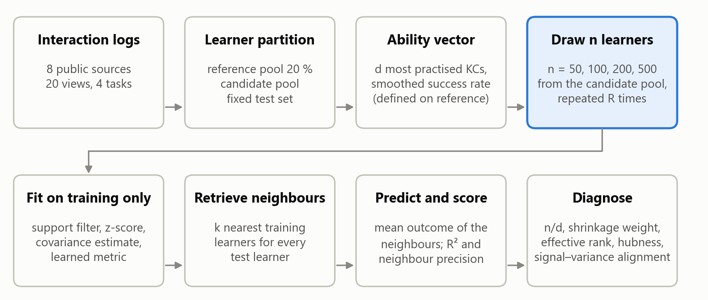

# Which Similarity Measure for Similar-Learner Retrieval? A Small-Sample Benchmark of Fixed, Covariance-Aware and Learned Metrics on Eight Public Datasets

Nguyễn Thanh Bình¹, Nguyễn Vũ Huy¹, Nguyễn Hoàng Tín¹, Võ Anh Hào¹, Vũ Ngọc Thanh Sang¹

¹ Faculty of Information Technology, Saigon University, Ho Chi Minh City, Vietnam

Corresponding author: Vũ Ngọc Thanh Sang ([email to be added])

ORCID: Nguyễn Thanh Bình, https://orcid.org/0009-0000-9285-7324

ORCID: Nguyễn Vũ Huy, https://orcid.org/0009-0004-3093-4565

ORCID: Nguyễn Hoàng Tín, https://orcid.org/0009-0006-0273-7956

**Draft status:** complete first draft generated from the experiment outputs on {{build_date}}. Every number, table and figure below is produced by the code in this repository from {{reps_min}} repetitions per cell.

---

## Abstract

{{file:manuscript/sections/abstract.md}}

**Keywords:** learner similarity, nearest-neighbour retrieval, Mahalanobis distance, metric learning, covariance shrinkage, small samples, knowledge tracing, benchmark, reproducibility

---

## 1. Introduction

Many educational systems answer a question about one learner by looking at other learners who resemble them. Retrieval-augmented knowledge tracing places the records of similar students in the prompt of a language model (Duan et al., 2025; Duan et al., 2026). Agents for adaptive learning pick the next exercise by weighting what worked for similar past learners (Lv et al., 2025). Cold-start methods match a new learner to a group of existing ones (Deng et al., 2025). In all of these systems one component decides which learners count as "similar": a similarity measure applied to a vector that describes each learner's ability.

That component is almost never examined. Lv et al. (2025) use the cosine similarity between mastery vectors produced by a knowledge-tracing model. Duan et al. (2026) combine a cosine term, a graph-distance term and an ability term with hand-set weights. Duan et al. (2025) use a Mahalanobis distance with a shrinkage covariance over five pair features. Deng et al. (2025) replace the measure with K-means clusters. None of these papers compares its choice with an alternative, and none reports how the choice behaves when few learners are available.

Two intuitions pull in opposite directions. Ability dimensions are correlated: skills share prerequisites, and a strong learner is strong on many skills at once. The Mahalanobis distance was designed for correlated variables (Mahalanobis, 1936), and a recent survey of learning-path recommendation names the correlation and poor identifiability of learner features as an open problem (Li et al., 2026). This suggests a covariance-aware measure. Yet the covariance matrix of d features has d(d + 1)/2 free entries, and a new course, a single class or a pilot deployment may offer only tens or hundreds of learners. The sample covariance is then badly conditioned or singular (Ledoit & Wolf, 2004). Supervised metric learning promises to learn which directions matter (Weinberger & Saul, 2009; Davis et al., 2007), but it adds parameters and needs outcome labels, and its own authors report mixed results on small data sets (Weinberger & Saul, 2009).

A practitioner who has n learners and d ability features therefore has no evidence to decide between the Euclidean distance, the cosine similarity, a Mahalanobis distance, or a learned metric. This paper provides that evidence. We ask four questions.

- **RQ1.** For training cohorts of 50, 100, 200 and 500 learners, which similarity measure gives the best nearest-neighbour prediction of a held-out outcome, and how does the ranking change with n and d?
- **RQ2.** How much does covariance shrinkage recover compared with the sample covariance, and do learned metrics improve on the best label-free measure?
- **RQ3.** Which properties of the data explain when a covariance-aware or learned measure helps or hurts?
- **RQ4.** Can a simple rule, or a selection made inside the training sample, choose the measure for a data set it has not seen?

The paper makes five contributions.

1. **A benchmark of {{n_measures}} similarity measures** (fixed, covariance-aware and learned) and three non-metric baselines on {{n_views}} learner views built from {{n_sources}} independent public sources, covering four prediction tasks and {{n_cells}} cells of (view, feature dimension, training size), with {{reps_min}} repetitions per cell.
2. **A leakage-controlled protocol**: learners are split before any feature is defined, every estimate is fitted on training learners only, and three protocol shortcuts (transductive scaling, a random instead of temporal outcome split, and training on the same module) are measured rather than assumed harmless.
3. **A mechanism**: a single diagnostic, the signal–variance alignment, that says whether the outcome is carried by high-variance or low-variance directions of the ability vector and explains when whitening hurts.
4. **A selection study**: fixed choices, rules learned on other sources, and selection inside the training sample are compared by their regret against the best measure of each cell under leave-one-source-out evaluation.
5. **A reproducibility package**: download script with checksums, view builder, experiment runner, analysis and figure code, pinned library versions and a datasheet. Only public, already anonymised data are used.

## 2. Related work

### 2.1 Similar-learner retrieval in knowledge tracing and path recommendation

Knowledge tracing estimates a learner's mastery from the history of their responses (Corbett & Anderson, 1995; Piech et al., 2015). A recent line of work adds retrieval. ReAL (Lv et al., 2025) builds a datastore of past learners keyed by their mastery vectors from a deep knowledge-tracing model and retrieves the five most similar ones with the cosine similarity. RAG-KT (Duan et al., 2026) retrieves two similar students with a hand-weighted mixture of a behaviour cosine, a graph path score and an item-response-theory ability gap. HISE-KT (Duan et al., 2025) scores candidate students with a Mahalanobis distance whose covariance is estimated from training pairs and regularised by shrinkage, over a five-dimensional vector of pair features. Its ablation removes the similar-student component as a whole and does not vary the distance. ACKT (Deng et al., 2025) addresses cold start across disciplines on PTADisc by clustering knowledge states with K-means, which is a hard notion of similarity.

Goal-oriented learning-path recommenders rarely retrieve learners at all. GEHRL (Li et al., 2023), KnowLP (Cheng et al., 2026) and IB-GRPO (Wang et al., 2026) encode the learner with a recurrent network or a mastery vector and are evaluated on simulators built from a knowledge-tracing model. Where a nearest-neighbour baseline appears, it uses the cosine similarity between learning paths. Outside knowledge tracing, the Mahalanobis distance has been used inside a density-based clustering of learners on OULAD (Bagunaid et al., 2022), again without a comparison with another distance.

We found no study that compares similarity measures for learner retrieval, and none that learns the metric. This statement is limited to the literature we read in full for this project and is not a systematic review.

### 2.2 Covariance-aware and learned metrics

The Mahalanobis distance (x − y)ᵀ M (x − y) with M = Σ⁻¹ equals the Euclidean distance after whitening the data. When n is not much larger than d, the sample covariance has a few very small eigenvalues and its inverse amplifies noise. Ledoit and Wolf (2004) and Chen et al. (2010) shrink the sample covariance towards a scaled identity with a data-driven weight; the result is always invertible. Truncated principal-component whitening regularises by discarding small eigenvalues instead.

Metric learning chooses M from supervision (Bellet et al., 2013; Kulis, 2013). Large-margin nearest neighbour (LMNN) pulls same-class neighbours together and pushes other classes away (Weinberger & Saul, 2009). Neighbourhood components analysis (NCA) maximises a soft leave-one-out nearest-neighbour accuracy (Goldberger et al., 2004). Information-theoretic metric learning (ITML) stays close to a prior metric in LogDet divergence under pair constraints (Davis et al., 2007). Sparse determinant metric learning (SDML) adds an ℓ1 penalty on the off-diagonal entries of M, which links it to sparse precision estimation (Qi et al., 2009; Friedman et al., 2008). Local Fisher discriminant analysis (LFDA) has a closed form (Sugiyama, 2007). Metric learning for kernel regression (MLKR) is fitted on a continuous outcome and needs no class labels (Weinberger & Tesauro, 2007). Bellet et al. (2013) note that LMNN can overfit without regularisation and depends on the Euclidean choice of target neighbours, and Davis et al. (2007) report higher variance when few constraints are available. Neither source studies the dependence on n and d for learner data.

### 2.3 Benchmarks and evaluation hygiene

Careful benchmarks have repeatedly changed what a field believed. Musgrave et al. (2020) re-evaluated deep metric learning under a common protocol and found that reported progress had been largely an artefact of unequal comparisons. Liu et al. (2022) standardised preprocessing for deep knowledge tracing and found that evaluation mistakes cause label leakage and that many recent models gain little over the original deep knowledge-tracing model. Hidasi and Czapp (2023) list widespread flaws in the offline evaluation of recommender systems, including temporal leakage. Feldbauer and Flexer (2019) compare hubness-reduction methods on 50 data sets with the Friedman and Nemenyi procedure of Demšar (2006); Benavoli et al. (2017) argue for Bayesian comparison with a region of practical equivalence.

Educational prediction has the same problems. In a review of 89 studies of reinforcement learning in education, 54 reported no statistical test (Riedmann et al., 2025). A review of educational recommender systems found that 12 of 28 studies optimised a rating target and only 5 used a public data set (Askarbekuly & Luković, 2024). On OULAD, replacing a random learner split by leave-one-module-out lowered the AUROC of an early-warning model from 0.716 to 0.661 (Lim, 2026), and an audit of seven public educational data sets found that several lose all predictive skill under group-disjoint evaluation (Ma & Zhang, 2026). Our protocol is designed against these failure modes, and Section 4.5 measures three of them directly.

## 3. Benchmark design

### 3.1 Task

Each learner i has an ability vector xᵢ ∈ ℝᵈ and an outcome yᵢ that is observed for training learners only. Given a query learner, a similarity measure retrieves the k most similar training learners, and the prediction is the mean outcome of those neighbours. The quality of the measure is the quality of this prediction on test learners who share no data with the training learners. This task isolates the retrieval component: it needs no simulator and no language model, so differences between measures cannot be attributed to another part of a larger system.

Figure 1 summarises the protocol.

*Figure 1. Benchmark protocol. The features are defined on a reference pool, training cohorts of n learners are drawn repeatedly from a candidate pool, and everything that is estimated (scaling, covariance, learned metric) uses the training cohort only. Test learners are fixed and never used for fitting.*

### 3.2 Data sources and views

We use eight independent public sources (Table 1): ASSISTments 2009, 2015 and 2017 (Feng et al., 2009), EdNet-KT1 (Choi et al., 2020) in the 20,000-learner sample released with DKT2 (Zhou et al., 2025), XES3G5M (Liu et al., 2023), the Slepemapy geography practice data (Papoušek et al., 2016), PTADisc (Hu et al., 2023) and OULAD (Kuzilek et al., 2017). They cover middle-school and primary mathematics, English practice, geography facts, university programming and computing courses, and distance higher education. The datasheet in the repository lists licences, download locations, checksums and the columns that are deliberately not read. No demographic attribute is used anywhere: for OULAD we do not load gender, region, education, deprivation band, age band or disability.

A *view* is a learner-level table with one outcome. The {{n_views}} views fall into four task types.

- **Future performance** (6 views). Features use the first 70 % of a learner's interactions; the outcome is the success rate on the last 30 %.
- **Cross-course transfer** (5 views). On the 29,454 PTADisc learners who took five programming courses, the outcome is the mean score in one held-out course and the features come from the other four.
- **Unseen skills** (3 views). On three PTADisc courses without timestamps, a random 70 % of the knowledge components supply the features and the outcome is the mean score on items of the remaining 30 %.
- **Early warning** (6 views). For six OULAD modules, the outcome is non-completion (fail or withdraw) and the features describe the first 28 days.

**Table 1. Views of the benchmark.** *pool* is the candidate pool from which training cohorts are drawn; *density* is the share of (learner, feature) entries backed by at least one attempt, given as the range over the feature dimensions d.

{{table:datasets}}

The five cross-course views share their learners, and the six OULAD views come from one institution. Whenever an analysis needs independent units, views are grouped into the eight sources.

### 3.3 Ability vectors

One rule builds the vectors for every interaction-log source. Learners are shuffled once per source and split into a reference pool (20 %, at most 3,000 learners), a fixed test set (at most 1,000) and a candidate pool. The reference pool alone defines the features: the d knowledge components (KCs) practised by the most reference learners are kept, with d ∈ {20, 50, 100}. For learner i and KC k with nᵢₖ attempts and cᵢₖ successes, the feature is the smoothed success rate

fᵢₖ = (cᵢₖ + a pₖ) / (nᵢₖ + a), with a = 2,

where pₖ is the mean success on KC k in the reference pool. A KC that the learner never attempted takes the value pₖ. The resulting vectors are sparse in the sense that matters here: at d = 100 only 12 % to 58 % of the entries are backed by an attempt (Table 1). OULAD has no KCs; its 32 features are registration lead time, previous attempts, studied credits, log-scaled click counts by week and by activity type, active days, distinct resources and the number of assessments handed in by day 28.

Inside each repetition, a column is dropped when fewer than five training learners depart from its most frequent value, which removes KCs that almost no training learner practised. The remaining columns are standardised with the training mean and standard deviation and clipped at ±5. Without the support filter, a KC practised by one or two training learners receives a near-zero standard deviation and dominates every distance; during development we observed strongly negative R² for the distance-based measures and for the linear model in such cohorts.

### 3.4 Similarity measures

Table 2 lists the {{n_measures}} measures. All except the two "raw" variants operate on the standardised vectors.

**Table 2. Similarity measures and baselines.**

| Family | Measure | Definition and settings |
|---|---|---|
| Fixed | Euclidean, Manhattan | ℓ2 and ℓ1 distance |
| Fixed | Cosine | 1 − cosine of the angle between the two vectors |
| Fixed | Pearson | cosine after centring each learner's vector |
| Fixed | Euclidean (raw), Cosine (raw) | the same on unstandardised success rates, as used on mastery vectors in earlier work |
| Covariance-aware | Mahalanobis (sample Σ) | M = pseudo-inverse of the sample covariance |
| Covariance-aware | Mahalanobis (Ledoit–Wolf), Mahalanobis (OAS) | M = inverse of the shrinkage covariance, weight chosen by the estimator |
| Covariance-aware | Mahalanobis α | M = ((1 − α) S + α I)⁻¹ for α ∈ {0.10, 0.25, 0.50, 0.75, 0.90}; α = 1 is Euclidean |
| Covariance-aware | PCA-95 % whitening | whitening restricted to the components that explain 95 % of the variance |
| Covariance-aware | PCA-80 % projection | Euclidean distance in the span of the components that explain 80 % of the variance, without whitening |
| Learned | LMNN | 3 target neighbours, 200 iterations (metric-learn 0.7.0) |
| Learned | NCA | 100 iterations (scikit-learn 1.7.2) |
| Learned | ITML, ITML (LW prior) | 20c² pair constraints, identity prior or Ledoit–Wolf precision as prior |
| Learned | SDML | Ledoit–Wolf precision as prior, sparsity 0.01, balance 0.5 (our re-implementation, see text) |
| Learned | LFDA | at most 7 neighbours |
| Learned | MLKR | 100 iterations, fitted on the continuous outcome |
| Non-metric | Ridge / logistic regression | penalty chosen by internal cross-validation |
| Non-metric | Random forest | 200 trees, minimum leaf size 3 |
| Non-metric | Gradient boosting | 150 iterations, learning rate 0.05, depth 3 |

The five fixed-α measures are used only to trace the path between the Mahalanobis and the Euclidean distance (Section 4.3); the main comparison ranks the other 18 measures. The Mahalanobis family is the family of Euclidean distances after a linear map, so the three covariance estimators differ only in how strongly they whiten.

The learned metrics that require class labels (LMNN, NCA, ITML, SDML, LFDA) receive the tertiles of the training outcome, or the two classes for the binary task. MLKR uses the outcome directly. SDML in metric-learn 0.7.0 calls a graphical-lasso routine with an argument that scikit-learn removed in version 1.5; we re-implemented the same estimator with the pair loss averaged per pair type and the eigenvalues of the input matrix floored at 10⁻³ of the largest. All other learners use the library implementations with the settings in Table 2. Hyper-parameters are fixed, not tuned per cell: the question is what a practitioner obtains from a standard configuration at small n, and tuning inside 50 learners is itself unreliable (Section 4.4). When a learner fails (for example a singular scatter matrix), the measure falls back to the Euclidean distance and the failure is counted (Section 4.6).

### 3.5 Prediction, scores and non-metric baselines

Predictions use the k = 10 nearest training learners with equal weights; k = 5 and k = 20 are reported as a sensitivity analysis. The score is

R² = 1 − MSE(prediction) / MSE(training-mean predictor),

computed on the test learners. For the binary outcome the prediction is the share of positive neighbours and R² is the Brier skill score, so all views share one scale on which 0 means "no better than predicting the training mean". We also report the AUC for the binary task and the *neighbour precision*, the share of the k retrieved learners who fall in the same outcome class as the query.

Three non-metric models are trained on the same standardised vectors to show what is achievable without retrieval. They are not competitors in the ranking of measures: a retrieval system needs neighbours, not only a prediction. Their predictions are clipped to [0, 1], the range of every outcome.

### 3.6 Protocol

A *cell* is a combination of view, feature dimension d and training size n ∈ {50, 100, 200, 500}. A cell is run only when the candidate pool holds at least 1.5 n learners, which gives {{n_cells}} cells. In each of {{reps_min}} repetitions per cell, n training learners are drawn without replacement from the candidate pool, all measures and models are fitted on them, and all are scored on the same fixed test learners. Comparisons between measures are therefore paired within a repetition. The benchmark comprises {{n_fits_knn|,d}} fitted measure–cohort pairs.

Three protocol variants are measured against this baseline.

1. **Transductive preprocessing.** Scaling and the covariance are estimated on training and test learners together, without labels. This is the common shortcut of standardising a table before splitting it.
2. **Random outcome split.** For three temporal sources, the outcome interactions are drawn at random from the learner's sequence instead of from its end.
3. **Leave-one-module-out.** For OULAD, the training cohort is drawn from the other five modules, after removing every learner who also appears in the held-out module.

### 3.7 Diagnostics and the signal–variance alignment

For every training cohort we record label-free properties of the standardised matrix: n/d, the Ledoit–Wolf shrinkage weight, the effective rank of the covariance (Roy & Vetterli, 2007) divided by d, the share of variance on the first principal component, the mean absolute correlation, the share of dropped columns, the two-nearest-neighbour estimate of intrinsic dimension (Facco et al., 2017) divided by d, and the skewness of the 10-occurrence distribution, a standard hubness measure (Radovanović et al., 2010).

We add one diagnostic that uses the training outcome. Let λⱼ be the eigenvalues of the training covariance, and ρⱼ the correlation between the outcome and the score on the j-th principal component. The **signal–variance alignment** is

SVA = Σⱼ ρⱼ² λⱼ / (Σⱼ ρⱼ² · λ̄), with λ̄ the mean eigenvalue.

SVA is the ρ²-weighted mean eigenvalue relative to the plain mean. SVA > 1 means that the outcome is carried by high-variance directions; SVA < 1 means that it is carried by low-variance directions.

The diagnostic follows from how the two distances treat the principal directions. A Euclidean ball has the same radius in every direction, so relative to the spread of the data it is narrow along high-variance directions and wide along low-variance ones: neighbours are matched mainly on the high-variance components, and the effective dimension of the search is close to the participation ratio (Σλ)² / Σλ², which is smaller than d when the features are correlated. Whitening gives every direction the same weight. It raises the effective dimension to the rank of the covariance, which makes the neighbourhoods larger for a given k, and it stops favouring the high-variance directions. If the outcome is carried by those directions (SVA > 1), whitening removes a useful bias and adds dimensions that carry little signal; if the outcome is carried by low-variance directions (SVA < 1), whitening should help. This argument is heuristic and we test its prediction in Section 4.3.

### 3.8 Statistical analysis

The unit of analysis is the cell mean over repetitions. Measures are compared by average rank with the Friedman test in the Iman–Davenport form and the Nemenyi critical difference (Demšar, 2006), separately for each n. Because cells from one source are not independent, we also report the same test with one block per source, and every confidence interval for a mean difference resamples whole sources (5,000 cluster-bootstrap replicates). Planned pairwise contrasts use the Wilcoxon signed-rank test with the Holm correction within each n, and the Bayesian signed-rank test (Benavoli et al., 2017) with a region of practical equivalence of ±{{rope}} in R², which returns the posterior probabilities that one measure is practically better, equivalent or worse. With eight sources, the source-level tests have little power; we treat them as a check on direction, and report the number of sources in which a difference is positive.

### 3.9 Selection strategies

For RQ4 the *regret* of a strategy in a cell is the R² of the best of the 18 measures in that cell minus the R² of the measure the strategy selects. We compare four kinds of strategy.

- **Always one measure**: each of the 18.
- **Best single measure, learned elsewhere**: the measure with the lowest mean regret on the other sources.
- **A rule learned elsewhere**: a regret-minimising tree of depth 1 or 2 on the diagnostics of Section 3.7 (thresholds at 17 quantiles, at least 8 cells per leaf).
- **Selection inside the training cohort**: the measure with the best leave-one-out nearest-neighbour R² among the training learners. This is a valid internal estimate for label-free measures. For learned metrics it is a resubstitution estimate, because the metric has already seen the left-out label; we include that naive variant to show its cost. A third variant tunes only the shrinkage weight α.

Rules and the best single measure are evaluated by leave-one-source-out: they are fitted on seven sources and applied to the eighth.

## 4. Results

{{file:manuscript/sections/results.md}}

## 5. Discussion

{{file:manuscript/sections/discussion.md}}

## 6. Conclusion

{{file:manuscript/sections/conclusion.md}}

---

## Reproducibility statement

The repository contains the download script with SHA-256 checksums of every source file, the view builder, the experiment runner, the analysis and figure code, and a build script that inserts every number of this manuscript from the analysis output. Library versions are pinned (Python 3.13, NumPy 2.2.5, SciPy 1.17.0, scikit-learn 1.7.2, metric-learn 0.7.0). Random seeds derive from the view name, the training size and the repetition index, so any single cohort can be regenerated. The full grid ran on a 12-core laptop processor without a GPU.

## Data availability and ethics

All data are public and were anonymised by their providers. Licences are listed in the datasheet; PTADisc and EdNet are restricted to non-commercial use. No data were collected for this study, no data from the authors' institution were used, and no demographic or otherwise sensitive attribute was read from any source.

## References

Askarbekuly, N., & Luković, I. (2024). Learning outcomes, assessment, and evaluation in educational recommender systems: A systematic review. *arXiv:2407.09500*.

Bagunaid, W., Chilamkurti, N., & Veeraraghavan, P. (2022). AISAR: Artificial intelligence-based student assessment and recommendation system for e-learning in big data. *Sustainability, 14*(17), 10551.

Bellet, A., Habrard, A., & Sebban, M. (2013). A survey on metric learning for feature vectors and structured data. *arXiv:1306.6709*.

Benavoli, A., Corani, G., Demšar, J., & Zaffalon, M. (2017). Time for a change: A tutorial for comparing multiple classifiers through Bayesian analysis. *Journal of Machine Learning Research, 18*(77), 1–36.

Chen, Y., Wiesel, A., Eldar, Y. C., & Hero, A. O. (2010). Shrinkage algorithms for MMSE covariance estimation. *IEEE Transactions on Signal Processing, 58*(10), 5016–5029.

Cheng, X., Zhang, Z., Wang, J., Fang, L., He, C., Guan, Q., Pan, S., & Luo, W. (2026). GraphRAG-induced dual knowledge structure graphs for personalized learning path recommendation. *Proceedings of the AAAI Conference on Artificial Intelligence, 40*(17), 14610–14620.

Choi, Y., Lee, Y., Shin, D., Cho, J., Park, S., Lee, S., et al. (2020). EdNet: A large-scale hierarchical dataset in education. In *Artificial Intelligence in Education* (AIED 2020). Springer.

Corbett, A. T., & Anderson, J. R. (1995). Knowledge tracing: Modeling the acquisition of procedural knowledge. *User Modeling and User-Adapted Interaction, 4*, 253–278.

Davis, J. V., Kulis, B., Jain, P., Sra, S., & Dhillon, I. S. (2007). Information-theoretic metric learning. In *Proceedings of the 24th International Conference on Machine Learning* (pp. 209–216).

Demšar, J. (2006). Statistical comparisons of classifiers over multiple data sets. *Journal of Machine Learning Research, 7*, 1–30.

Deng, Y., Guan, Z., He, M., Wang, X., Liu, J., & Li, Z. (2025). Adaptive knowledge transfer for cross-disciplinary cold-start knowledge tracing. *arXiv:2511.20009*.

de Vazelhes, W., Carey, C. J., Tang, Y., Vauquier, N., & Bellet, A. (2020). metric-learn: Metric learning algorithms in Python. *Journal of Machine Learning Research, 21*(138), 1–6.

Duan, Z., Shi, Z., Yuan, H., & Wang, Q. (2025). HISE-KT: Synergizing heterogeneous information networks and LLMs for explainable knowledge tracing with meta-path optimization. *arXiv:2511.15191*.

Duan, Z., Yuan, H., & Liu, R. (2026). RAG-KT: Cross-platform explainable knowledge tracing with multi-view fusion retrieval generation. *arXiv:2604.10960*.

Facco, E., d'Errico, M., Rodriguez, A., & Laio, A. (2017). Estimating the intrinsic dimension of datasets by a minimal neighborhood information. *Scientific Reports, 7*, 12140.

Feldbauer, R., & Flexer, A. (2019). A comprehensive empirical comparison of hubness reduction in high-dimensional spaces. *Knowledge and Information Systems, 59*(1), 137–166.

Feng, M., Heffernan, N., & Koedinger, K. (2009). Addressing the assessment challenge with an online system that tutors as it assesses. *User Modeling and User-Adapted Interaction, 19*(3), 243–266.

Friedman, J., Hastie, T., & Tibshirani, R. (2008). Sparse inverse covariance estimation with the graphical lasso. *Biostatistics, 9*(3), 432–441.

Goldberger, J., Roweis, S., Hinton, G., & Salakhutdinov, R. (2004). Neighbourhood components analysis. In *Advances in Neural Information Processing Systems 17*.

Hidasi, B., & Czapp, Á. T. (2023). Widespread flaws in offline evaluation of recommender systems. In *Proceedings of the 17th ACM Conference on Recommender Systems* (pp. 848–855).

Hu, L., Dong, Z., Chen, J., Wang, G., Wang, Z., Zhao, Z., & Wu, F. (2023). PTADisc: A cross-course dataset supporting personalized learning in cold-start scenarios. In *Advances in Neural Information Processing Systems 36* (Datasets and Benchmarks Track).

Kulis, B. (2013). Metric learning: A survey. *Foundations and Trends in Machine Learning, 5*(4), 287–364.

Kuzilek, J., Hlosta, M., & Zdrahal, Z. (2017). Open University Learning Analytics dataset. *Scientific Data, 4*, 170171.

Ledoit, O., & Wolf, M. (2004). A well-conditioned estimator for large-dimensional covariance matrices. *Journal of Multivariate Analysis, 88*(2), 365–411.

Li, Q., Xia, W., Yin, L., Shen, J., Rui, R., Zhang, W., Chen, X., Tang, R., & Yu, Y. (2023). Graph enhanced hierarchical reinforcement learning for goal-oriented learning path recommendation. In *Proceedings of the 32nd ACM International Conference on Information and Knowledge Management* (pp. 1318–1327).

Li, A., Li, Y., & Gao, X. (2026). Personalized learning path recommendation based on knowledge graphs: A survey. *Electronics, 15*(1), 238.

Lim, M. (2026). Student-disjoint cross-module benchmarking for calibrated early warning in online learning. *International Journal of Advanced Computer Science and Applications, 17*(9), 617–623.

Liu, Z., Liu, Q., Chen, J., Huang, S., Tang, J., & Luo, W. (2022). pyKT: A Python library to benchmark deep learning based knowledge tracing models. In *Advances in Neural Information Processing Systems 35* (Datasets and Benchmarks Track).

Liu, Z., Liu, Q., Guo, T., Chen, J., Huang, S., Zhao, X., Tang, J., Luo, W., & Weng, J. (2023). XES3G5M: A knowledge tracing benchmark dataset with auxiliary information. In *Advances in Neural Information Processing Systems 36* (Datasets and Benchmarks Track).

Lv, R., Liu, Q., Gao, W., Li, J., Zhang, K., & Tong, S. (2025). ReAL: How can LLMs simulate the real teacher? Retrieval-enhanced agent for adaptive learning. In *Findings of the Association for Computational Linguistics: EMNLP 2025* (pp. 168–181).

Ma, Y., & Zhang, L. (2026). Limited structural reliability in public educational prediction benchmarks: A four-dimension audit of seven datasets. *arXiv:2609.29625*.

Mahalanobis, P. C. (1936). On the generalized distance in statistics. *Proceedings of the National Institute of Sciences of India, 2*(1), 49–55.

Musgrave, K., Belongie, S., & Lim, S.-N. (2020). A metric learning reality check. In *Computer Vision – ECCV 2020*. Springer.

Papoušek, J., Pelánek, R., & Stanislav, V. (2016). Adaptive geography practice data set. *Journal of Learning Analytics, 3*(2), 317–321.

Pedregosa, F., Varoquaux, G., Gramfort, A., Michel, V., Thirion, B., Grisel, O., et al. (2011). Scikit-learn: Machine learning in Python. *Journal of Machine Learning Research, 12*, 2825–2830.

Piech, C., Bassen, J., Huang, J., Ganguli, S., Sahami, M., Guibas, L., & Sohl-Dickstein, J. (2015). Deep knowledge tracing. In *Advances in Neural Information Processing Systems 28*.

Qi, G.-J., Tang, J., Zha, Z.-J., Chua, T.-S., & Zhang, H.-J. (2009). An efficient sparse metric learning in high-dimensional space via ℓ1-penalized log-determinant regularization. In *Proceedings of the 26th International Conference on Machine Learning*.

Radovanović, M., Nanopoulos, A., & Ivanović, M. (2010). Hubs in space: Popular nearest neighbors in high-dimensional data. *Journal of Machine Learning Research, 11*, 2487–2531.

Riedmann, A., Schaper, P., & Lugrin, B. (2025). Reinforcement learning in education: A systematic literature review. *International Journal of Artificial Intelligence in Education, 35*(5), 2669–2723.

Roy, O., & Vetterli, M. (2007). The effective rank: A measure of effective dimensionality. In *15th European Signal Processing Conference* (pp. 606–610).

Sugiyama, M. (2007). Dimensionality reduction of multimodal labeled data by local Fisher discriminant analysis. *Journal of Machine Learning Research, 8*, 1027–1061.

Wang, S., Yang, Y., Li, B., Hao, H., & Zhou, A. (2026). IB-GRPO: Aligning LLM-based learning path recommendation with educational objectives via indicator-based group relative policy optimization. *arXiv:2601.14686*.

Weinberger, K. Q., & Saul, L. K. (2009). Distance metric learning for large margin nearest neighbor classification. *Journal of Machine Learning Research, 10*, 207–244.

Weinberger, K. Q., & Tesauro, G. (2007). Metric learning for kernel regression. In *Proceedings of the 11th International Conference on Artificial Intelligence and Statistics* (pp. 612–619).

Zhou, Y., Han, W., & Chen, J. (2025). DKT2: Revisiting applicable and comprehensive knowledge tracing in large-scale data. In *ECML PKDD 2025*. *arXiv:2501.14256*.

## Appendix A. Additional tables

{{file:manuscript/sections/appendix.md}}
